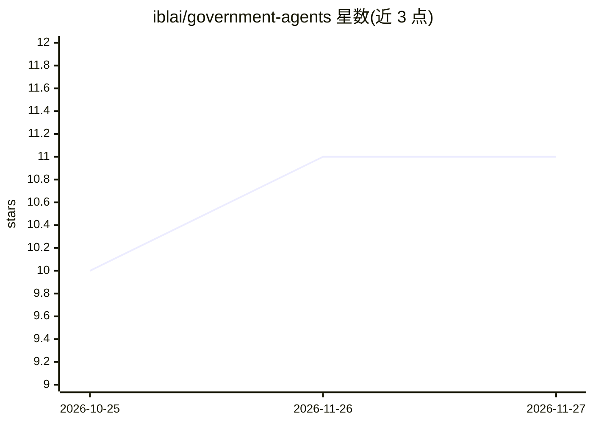

# iblai/government-agents

⭐ 11 · MIT · 推送 2026-06-08 · [GitHub](https://github.com/iblai/government-agents) · [官网](https://ibl.ai/solutions/government) · 组织维护

**面向政府机构的 OpenClaw/NemoClaw 多 agent 配置包**

ibl.ai Government 解决方案段的 agent 配置目录：包含 1 个 Agency Assistant 编排 agent 与 12 个专项子 agent（市民服务、政策知识、合规审计、预算、采购等），通过 sessions_spawn 工具进行意图路由与结果汇总。以复制目录的方式导入 NemoClaw/OpenClaw 沙箱主机，附带 10 个第三方平台的 SKILL.md 工具技能（国会数据、联邦法规、ServiceNow、Salesforce 政府云等），依赖替换 auth-profiles.json 中的 Anthropic API 密钥并重算配置哈希后重载网关。

## 筛选速览

| 维度 | 判定 | 备注 |
|---|---|---|
| AI 角色 | `ai-ecosystem` | LLM/agent 周边工具 |
| 许可风险 | `permissive` | MIT |
| 部署形态 | `None` |  |
| 模型依赖 | — | README 未给出锁定关系 |
| 硬件要求 | — | 无带数字的原话,不猜 |
| 安装摩擦 | `medium` | 含编译或系统依赖之一 |
| 成熟度 | — | 结构信号不足 |

## 能力要点

- 1 个编排 agent + 12 个专项子 agent 的多 agent 结构
- 10 个第三方政府/企业平台的 SKILL.md 工具技能
- MIT 许可，git clone 后复制导入即可使用

## 适用场景

- 为政府机构部署多 agent 助手团队
- 让 agent 调用国会议案、联邦法规、联邦支出等公开 API
- 接入 ServiceNow/Salesforce 政府云等 ITSM/CRM 系统的 agent 工具

## 场景标签

`多智能体` `AI 助手` · 领域:Agent 开发

## 证据(README 行号)

> L5: Drop-in OpenClaw / NemoClaw agent configuration for the ibl.ai **Government** solution segment — one Agency Assistan
> L12: This directory is a complete, drop-in NemoClaw/OpenClaw configuration for the **Government** solution segment. It c
> L41: The `government-assistant` is the default entry point (`"default": true` in `openclaw.json`). It interprets intent 

## 星数曲线

2026-10-25 10 → 2026-11-27 11（+1）

---
*卡片 v1 · prompt 1.4 · 生成 2026-11-19 · 置信度 high · 依据 README sha `e1415c30e0ad` · [字段定义](../../DATASET.md)*
