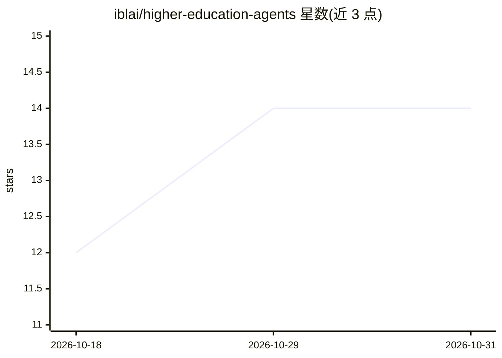

# iblai/higher-education-agents

⭐ 14 · MIT · 推送 2026-06-08 · [GitHub](https://github.com/iblai/higher-education-agents) · [官网](https://ibl.ai/solutions/higher-education) · 组织维护

**面向高校的 OpenClaw/NemoClaw 多 agent 配置包：1 个编排者加 16 个专业子 agent**

ibl.ai 维护的高等教育 agent 配置目录：包含一个 Campus Assistant 父 agent 负责路由请求并通过 sessions_spawn 分派，以及覆盖招生、经济资助、学业指导、辅导、就业、IT 支持等职能的 16 个专业子 agent。随附 10 个对接第三方平台的技能（Banner、Canvas、Salesforce Education Cloud、Workday 等），凭据经 auth-profiles.json 与 .env 配置。安装方式为 git clone 后复制到 NemoClaw 沙箱的 /sandbox/.openclaw/ 目录，需替换 Anthropic API key 并重算配置哈希。MIT 许可。

## 筛选速览

| 维度 | 判定 | 备注 |
|---|---|---|
| AI 角色 | `ai-ecosystem` | LLM/agent 周边工具 |
| 许可风险 | `permissive` | MIT |
| 部署形态 | `None` |  |
| 模型依赖 | — | README 未给出锁定关系 |
| 硬件要求 | — | 无带数字的原话,不猜 |
| 安装摩擦 | `low` | 无编译、无系统依赖或容器化 |
| 成熟度 | — | 结构信号不足 |

## 能力要点

- 1 个父 agent 编排 + 16 个专业子 agent 的完整名单
- 10 个技能对接 Ellucian Banner、Canvas、Salesforce、Workday 等高校系统
- 支持 OpenClaw 网关导入（git clone 复制 + 配置哈希重算 + reload）

## 适用场景

- 高校部署覆盖招生到校友事务的多 agent 校园助手
- 让 agent 查询 SIS/LMS/CRM 等校内系统数据
- 作为 ibl.ai 高等教育方案的 OpenClaw/NemoClaw 落地配置

## 场景标签

`多智能体` · 领域:Agent 开发

## 证据(README 行号)

> L5: Drop-in OpenClaw / NemoClaw agent configuration for the ibl.ai **Higher Education** solution segment — one Campus As
> L12: This directory is a complete, drop-in NemoClaw/OpenClaw configuration for the Higher Education solution segment. Co
> L115: The default agent — `higher-education-assistant` (Campus Assistant) — is the segment entry point. All incoming con

## 星数曲线

2026-10-18 12 → 2026-10-31 14（+2）

---
*卡片 v1 · prompt 1.4 · 生成 2026-10-31 · 置信度 high · 依据 README sha `17c9a0b17e5a` · [字段定义](../../DATASET.md)*
