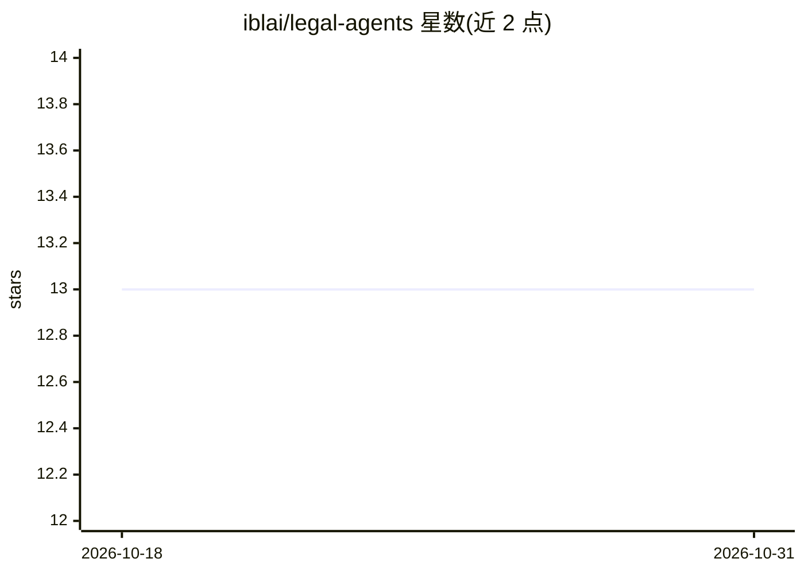

# iblai/legal-agents

⭐ 13 · MIT · 推送 2026-06-08 · [GitHub](https://github.com/iblai/legal-agents) · [官网](https://ibl.ai/solutions/legal) · 组织维护

**律所运营 agent 配置包：1 个总编排 + 12 个专业子代理**

面向 ibl.ai Legal 方案的开箱即用 OpenClaw/NemoClaw agent 配置：一个 Firm Assistant 总编排代理负责意图识别，通过 sessions_spawn 分派到法律研究、合同审查、客户接收、计费、合规、利益冲突核查等 12 个专业子代理，多域请求按序编排（冲突核查先于客户接收）。安装方式为 git clone 后复制到 /sandbox/.openclaw/ 并填入 Anthropic API key 与第三方平台凭证。集成 Clio、Westlaw、PACER、DocuSign、Ironclad 等 11 个平台技能；声明代理不提供法律意见，输出须经执业律师审核。

## 筛选速览

| 维度 | 判定 | 备注 |
|---|---|---|
| AI 角色 | `ai-ecosystem` | LLM/agent 周边工具 |
| 许可风险 | `permissive` | MIT |
| 部署形态 | `None` |  |
| 模型依赖 | locked-api |  |
| 硬件要求 | — | 无带数字的原话,不猜 |
| 安装摩擦 | `low` | 无编译、无系统依赖或容器化 |
| 成熟度 | — | 结构信号不足 |

## 能力要点

- Firm Assistant 编排 + 12 个律所专业子代理
- 11 个第三方平台技能（Clio/Westlaw/PACER/DocuSign 等）
- 零转换 drop-in 导入 NemoClaw 沙箱
- 默认模型 anthropic/claude-sonnet-4-5-20250929，可改

## 适用场景

- 为律所部署覆盖研究、合同、计费、合规的全流程 AI 代理
- 在 NemoClaw/OpenClaw 主机上导入整套法律代理配置
- 让代理对接 Clio、Westlaw 等既有法律平台执行操作

## 场景标签

`多智能体` · 领域:Agent 开发

## 证据(README 行号)

> L5: Drop-in OpenClaw / NemoClaw agent configuration for the ibl.ai **Legal** solution segment — one Firm Assistant orche
> L12: This directory is a complete, drop-in NemoClaw/OpenClaw configuration for the **Legal** solution segment. It define
> L39: 2. Spawns the appropriate specialist subagent via `sessions_spawn`.

## 星数曲线

2026-10-18 13 → 2026-10-31 13（+0）

---
*卡片 v1 · prompt 1.4 · 生成 2026-10-31 · 置信度 high · 依据 README sha `ac2df90660b2` · [字段定义](../../DATASET.md)*
