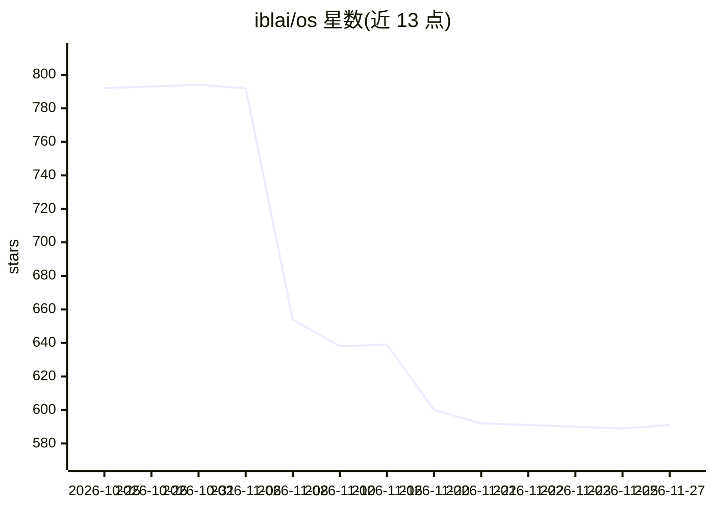

# iblai/os

⭐ 591 · TypeScript · MIT · 推送 2026-11-26 · [GitHub](https://github.com/iblai/os) · [官网](https://ibl.ai/join) · 组织维护

**给企业构建、部署和管理多平台 AI 对话 agent 的开源前端**

ibl.ai/os 是 ibl.ai 平台的前端代码库，MIT 许可、可自托管，用于构建和管理可配置的对话式 agent：支持自定义 LLM、系统提示词、工具与安全过滤，提供 RAG 训练（文档上传、网盘接入、网站爬取）、实时语音通话（LiveKit/WebRTC）、屏幕共享、深度研究、用量分析、多租户、SSO/RBAC、Stripe 计费与 iframe 嵌入。同一代码库以 Web、macOS、Windows、Linux、iOS、Android 形态分发。仓库仅含前端，运行需 ibl.ai 后端平台提供认证与 agent API；企业后端需单独获取许可。

## 筛选速览

| 维度 | 判定 | 备注 |
|---|---|---|
| AI 角色 | `ai-native` | 本体是模型或模型工具 |
| 许可风险 | `permissive` | MIT |
| 部署形态 | `desktop` | 安装包/桌面程序 |
| 模型依赖 | — | README 未给出锁定关系 |
| 硬件要求 | — | 无带数字的原话,不猜 |
| 安装摩擦 | `low` | 无编译、无系统依赖或容器化 |
| 成熟度 | — | 结构信号不足 |

## 能力要点

- MIT 许可前端，一套代码覆盖 Web/macOS/Windows/Linux/iOS/Android
- Agent 配置支持任意 LLM 提供方切换（OpenAI/Anthropic/Google/Microsoft/Meta/自有模型）
- RAG 训练、LiveKit 实时语音通话、MCP 工具服务器接入
- 内置多租户、SSO（OAuth/OIDC/SAML）、RBAC、Stripe 计费与白标

## 适用场景

- 企业自托管搭建多租户 AI 对话助手平台
- 将 agent 通过 iframe/API 嵌入自有产品并白标
- 接文档与网盘知识库训练面向客户的支持/答疑机器人

## 场景标签

`聊天机器人` `语音 Agent` `RAG` `文档问答` · 领域:对话与助手

## 证据(README 行号)

> L5: **Open Source Agentic Operating System.**
> L59: - **AI Agents** — configurable LLMs, system prompts, tools, and safety filters
> L170: > **Note**: ibl.ai/os requires the ibl.ai backend platform for authentication, AI agent APIs, and data services. T

## 星数曲线

2026-10-25 792 → 2026-11-27 591（-201）

---
*卡片 v1 · prompt 1.4 · 生成 2026-11-25 · 置信度 high · 依据 README sha `08002a456952` · [字段定义](../../DATASET.md)*
