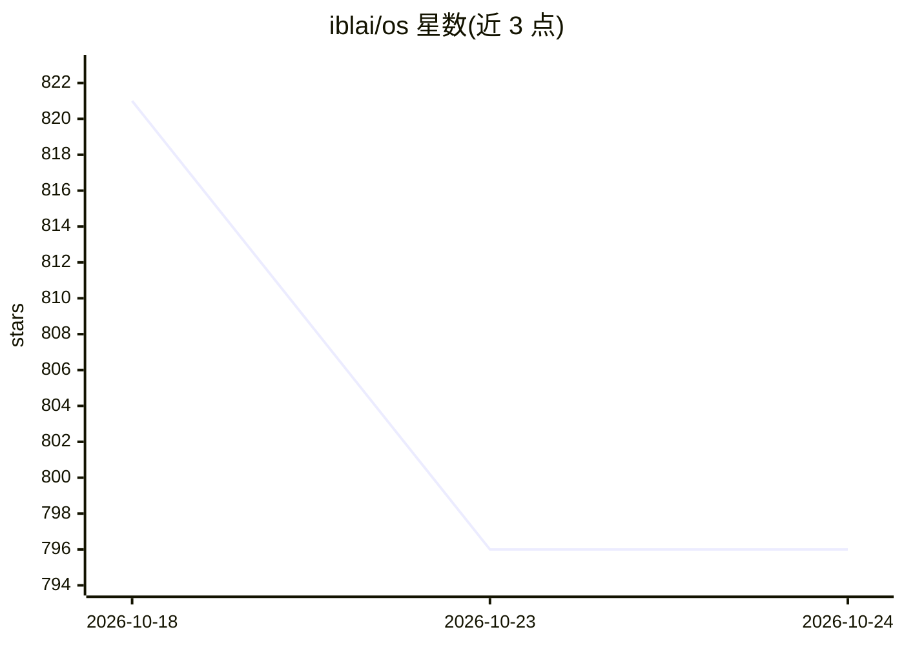

# iblai/os

⭐ 796 · TypeScript · MIT · 推送 2026-10-23 · [GitHub](https://github.com/iblai/os) · [官网](https://ibl.ai/join) · 组织维护

**开源 AI agent 平台 ibl.ai 的多端前端，用于构建和管理会话式 agent**

由 ibl.ai 团队维护的 MIT 许可前端代码库，功能覆盖 agent 配置（LLM、系统提示、安全过滤）、RAG 文档训练、网页搜索、WebRTC 语音通话、分析看板、多租户、SSO/RBAC、Stripe 计费与白标。同一代码可发布为 Web、Chrome 扩展、macOS/Windows/Linux/iOS/Android 应用（Tauri webview 壳）。限制：本仓库不含后端，需连接 ibl.ai 后端平台运行；本地开发用 pnpm，部署支持 Docker 或 Next.js standalone 输出。

## 筛选速览

| 维度 | 判定 | 备注 |
|---|---|---|
| AI 角色 | `ai-ecosystem` | LLM/agent 周边工具 |
| 许可风险 | `permissive` | MIT |
| 部署形态 | `desktop` | 安装包/桌面程序 |
| 模型依赖 | — | README 未给出锁定关系 |
| 硬件要求 | — | 无带数字的原话,不猜 |
| 安装摩擦 | `low` | 无编译、无系统依赖或容器化 |
| 成熟度 | — | 结构信号不足 |

## 能力要点

- 同一代码库发布 Web/Chrome/macOS/Windows/Linux/iOS/Android 七端
- agent 配置、RAG 训练、MCP 工具服务器、语音通话等功能集合
- 多租户、SSO/RBAC、Stripe 计费、白标等企业功能内置于前端
- 构建时可通过环境变量锁定租户与启用应用内购买

## 适用场景

- 组织搭建可白标的多 agent 对话服务
- 把 agent 以 iframe 或 API 形式嵌入自己的产品
- 在不同设备上为用户提供统一的 agent 会话入口

## 场景标签

`聊天机器人` `RAG` `多智能体` `Agent 框架` · 领域:Agent 开发

## 证据(README 行号)

> L7: Build, deploy, and manage intelligent conversational agents — from prototype to production, in minutes. One codebase
> L66: - **AI Agents** — configurable LLMs, system prompts, tools, and safety filters
> L126: ibl.ai/os is the frontend for the ibl.ai platform. Choose your path based on your backend setup:

## 星数曲线

2026-10-18 821 → 2026-10-24 796（-25）

---
*卡片 v1 · prompt 1.4 · 生成 2026-10-21 · 置信度 mid · 依据 README sha `c66183c7fa72` · [字段定义](../../DATASET.md)*
