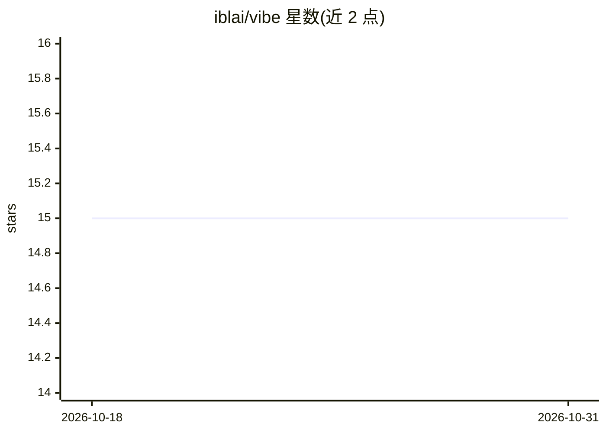

# iblai/vibe

⭐ 15 · JavaScript · MIT · 推送 2026-10-30 · [GitHub](https://github.com/iblai/vibe) · [官网](https://ibl.ai/join) · 组织维护

**面向 ibl.ai 平台的 AI 应用脚手架与 agent 技能工具集**

ibl.ai 团队维护的开发者工具集：通过 Claude Code/Cursor/Copilot 等编程 agent 安装约 40 个 /iblai-vibe-* 技能，用于在 ibl.ai 托管平台上脚手架并搭建生产级 Next.js 应用——SSO 认证、agent 聊天、项目/资料/通知/分析/RBAC 管理界面、edX 课程创建等。附 @iblai/mcp MCP 服务器供 AI 助手查询组件与 Hook 文档，支持 Vercel 部署与 Tauri 桌面/移动构建，另含 8 个安全审计技能。工具包 MIT 许可，但运行依赖托管 iblai.app 环境，平台源码需另行联系商业授权。

## 筛选速览

| 维度 | 判定 | 备注 |
|---|---|---|
| AI 角色 | `ai-ecosystem` | LLM/agent 周边工具 |
| 许可风险 | `permissive` | MIT |
| 部署形态 | `library` | 以包/库形式分发 |
| 模型依赖 | — | README 未给出锁定关系 |
| 硬件要求 | — | 无带数字的原话,不猜 |
| 安装摩擦 | `low` | 无编译、无系统依赖或容器化 |
| 成熟度 | — | 结构信号不足 |

## 能力要点

- 约 40 个 agent 技能覆盖认证、聊天、分析、RBAC、通知、edX 课程等平台功能
- @iblai/mcp MCP 服务器提供组件/Hook/API 文档查询与页面模板生成
- 支持 Tauri 桌面（macOS/Windows）与移动（iOS/Android）构建及 Windows MSIX 打包
- 8 个授权用途安全技能（OWASP 源码审计、提示注入测试等）

## 适用场景

- 用现有编程 agent 快速搭建接入 ibl.ai 平台的带认证与 AI 聊天的应用
- 为 ibl.ai 平台应用生成分析仪表盘、通知中心、RBAC 管理界面
- 将应用构建为桌面与移动应用并发布

## 场景标签

`代码生成` · 领域:编码与开发

## 证据(README 行号)

> L20: Build the app you actually need on ibl.ai — sign-in, an AI
> L30: npx skills add iblai/vibe --all        # Claude Code, OpenAI Codex, Cursor, OpenCode, Copilot …
> L109: This gives your AI assistant access to:

## 星数曲线

2026-10-18 15 → 2026-10-31 15（+0）

---
*卡片 v1 · prompt 1.4 · 生成 2026-10-30 · 置信度 high · 依据 README sha `a7eb715a88dd` · [字段定义](../../DATASET.md)*
