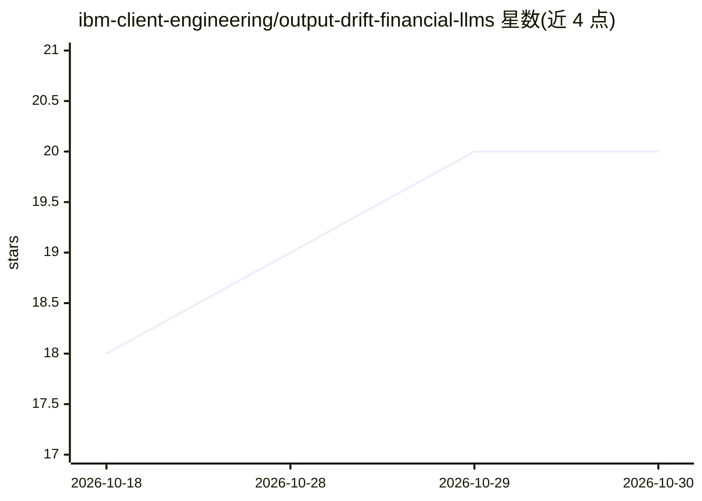

# ibm-client-engineering/output-drift-financial-llms

⭐ 20 · Python · MIT · 推送 2026-10-20 · [GitHub](https://github.com/ibm-client-engineering/output-drift-financial-llms) · [官网](https://ibm-client-engineering.github.io/output-drift-financial-llms/) · 个人维护

**金融场景 LLM 输出漂移与 agent 回放稳定性的可复现基准（DFAH-Bench）**

DFAH-Bench 是一个金融 AI 研究工件与 alpha 阶段 Python 包（dfah-bench），测量重复运行的工具调用 agent 是否保持决策与可观测执行路径的一致性：提供决策一致率（DAR）、有序工具名路径一致率（TARseq）、强轨迹一致性等指标，支持回放资格 fail-closed 判定、只追加 episode 存储、OpenTelemetry GenAI spans 与 pytest 插件。面向研究者和 agent 开发者；含 v2 保留结果（4,157 episodes）与配套 workshop 论文。不检验隐藏推理、正确性、安全性或合规性；不构成模型排行榜。

## 筛选速览

| 维度 | 判定 | 备注 |
|---|---|---|
| AI 角色 | `ai-ecosystem` | LLM/agent 周边工具 |
| 许可风险 | `permissive` | MIT |
| 部署形态 | `library` | 以包/库形式分发 |
| 模型依赖 | — | README 未给出锁定关系 |
| 硬件要求 | — | 无带数字的原话,不猜 |
| 安装摩擦 | `low` | 无编译、无系统依赖或容器化 |
| 成熟度 | `idea` | |

## 能力要点

- 决策一致率与工具路径/轨迹一致率分列测量（DAR/TARseq/强轨迹）
- 回放资格 fail-closed：缺失通道不折算为一致，直接判不合格
- 本地快速验证无需 API key，含确定性冒烟测试
- 提供版本化套件、只追加 episode 存储、OpenTelemetry GenAI spans 与 pytest 插件

## 适用场景

- 我在金融 agent 上线前检测重复运行的决策与执行路径漂移
- 我用它复现论文的 4,157 episode 基准分析（make reproduce-paper）
- 接入自有 agent（check-agent）做回放捕获与评审

## 场景标签

`模型评测` · 领域:评测与运维

## 证据(README 行号)

> L3: **Replay stability measurement for tool-using AI agents**
> L9: DFAH-Bench is a financial AI research artifact and alpha Python package for
> L144: |Decision Agreement Rate (DAR)|Modal final-decision share within an eligible replay group|

## 星数曲线

2026-10-18 18 → 2026-10-30 20（+2）

---
*卡片 v1 · prompt 1.4 · 生成 2026-10-28 · 置信度 high · 依据 README sha `8093fdf0bba7` · [字段定义](../../DATASET.md)*
