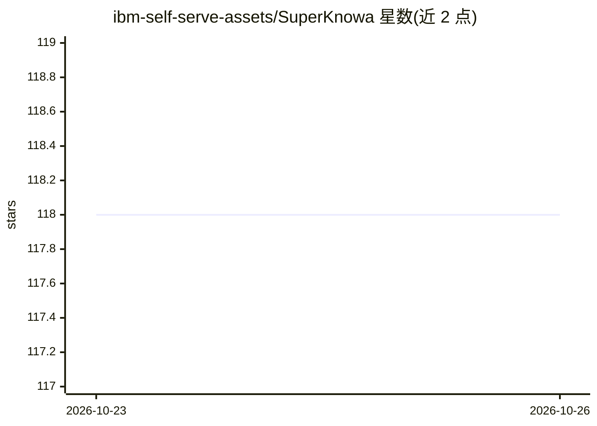

# ibm-self-serve-assets/SuperKnowa

⭐ 118 · Jupyter Notebook · Apache-2.0 · 推送 2026-10-23 · [GitHub](https://github.com/ibm-self-serve-assets/SuperKnowa) · 组织维护

**IBM 出品的企业级 RAG 流水线搭建框架**

基于 IBM watsonx 构建的企业 RAG 框架，以可插拔组件（索引/神经检索/重排/上下文学习/评测/微调/RLHF/部署）形式组装流水线，通过 config.yaml 单文件配置并运行 LLMQnA.py 脚本。涵盖私有知识库问答、PDF 问答、摘要、Text-to-SQL 等用例，附带 LLM 评测工具包（BLEU/ROUGE 等统计指标）与 MLflow 实验跟踪、AI 对齐人工反馈工具。声明在 1M-200M 私有知识库上验证，依赖 watsonx、LLAMA 等产品的服务条款，非正式产品。

## 筛选速览

| 维度 | 判定 | 备注 |
|---|---|---|
| AI 角色 | `ai-ecosystem` | LLM/agent 周边工具 |
| 许可风险 | `permissive` | Apache-2.0 |
| 部署形态 | `None` |  |
| 模型依赖 | — | README 未给出锁定关系 |
| 硬件要求 | — | 无带数字的原话,不猜 |
| 安装摩擦 | `low` | 无编译、无系统依赖或容器化 |
| 成熟度 | — | 结构信号不足 |

## 能力要点

- 组件化（Lego 式）RAG 流水线，config.yaml 单文件配置
- 索引支持 Elasticsearch/Solr/Watson Discovery，含重排与神经检索
- LLM 评测工具包：BLEU/ROUGE/METEOR/BERT score 等指标 + MLflow 跟踪与榜单
- AI 对齐工具：人工反馈采集与结果管理仪表板

## 适用场景

- 在企业私有知识库上搭建问答与文档摘要应用
- 评测并对比多个 LLM 在自定义数据集上的表现
- 通过 Text-to-SQL 用自然语言查询数据库

## 场景标签

`RAG` `模型评测` `数据分析` · 领域:效率与自动化

## 证据(README 行号)

> L3: **Fast Framework to build Enterprise RAG (Retriever Augmented Generation) Pipelines at Scale - powered by watsonx**
> L5: Welcome to the SuperKnowa GitHub repository! SuperKnowa framework accelerates your Enterprise Generative AI applicat
> L31: You can get started by updating the `config.yaml` file and run the LLMQnA.py script for quickly configuring your RA

## 星数曲线

2026-10-23 118 → 2026-10-26 118（+0）

---
*卡片 v1 · prompt 1.4 · 生成 2026-10-23 · 置信度 high · 依据 README sha `c86a478e4eda` · [字段定义](../../DATASET.md)*
