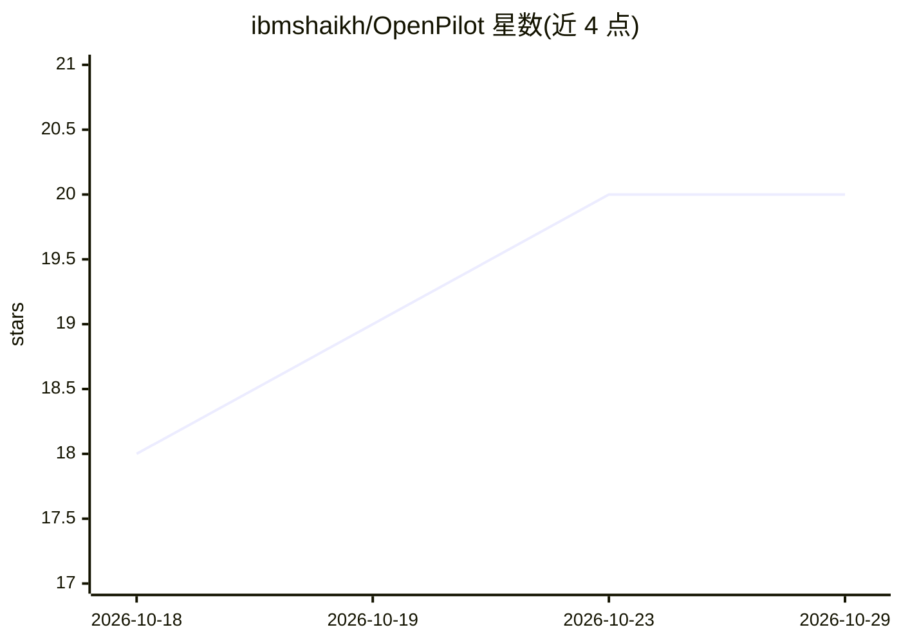

# ibmshaikh/OpenPilot

⭐ 20 · JavaScript · MIT · 推送 2026-10-18 · [GitHub](https://github.com/ibmshaikh/OpenPilot) · [官网](https://openpilot.in/) · 个人维护

**本地运行的 AI agent 桌面应用：接入自有 LLM 操作项目文件**

基于 Electron 的聊天式 AI agent 桌面应用，本地运行，自带 API key。支持任意 OpenAI 兼容端点（含本地服务器与自定义网关），可按聊天切换多模型；agent 可读取、编辑用户指定项目文件夹中的文件并执行工具。可选接入 TinyFish 做实时网页搜索与抓取，支持 MCP 服务器工具、可复用 Skills、持久记忆与敏感操作审批。macOS/Windows 提供预构建安装包，也可 Node.js 20+ 从源码运行。默认发送匿名遥测数据，可在设置关闭。

## 筛选速览

| 维度 | 判定 | 备注 |
|---|---|---|
| AI 角色 | `ai-native` | 本体是模型或模型工具 |
| 许可风险 | `permissive` | MIT |
| 部署形态 | `desktop` | 安装包/桌面程序 |
| 模型依赖 | — | README 未给出锁定关系 |
| 硬件要求 | — | 无带数字的原话,不猜 |
| 安装摩擦 | `low` | 无编译、无系统依赖或容器化 |
| 成熟度 | — | 结构信号不足 |

## 能力要点

- 任意 OpenAI 兼容端点接入，key 本地保存不锁定厂商
- agent 可读写指定项目文件夹并执行 shell/工具，敏感操作需审批
- MCP 服务器工具接入与用户/项目级 Skills
- 可选 TinyFish 实时网页搜索与 URL 抓取

## 适用场景

- 在自己的项目文件夹里让 agent 读写文件和执行工具
- 用自选模型（含本地服务器）进行对话式开发辅助
- 通过 MCP 与 Skills 扩展 agent 能力

## 场景标签

`AI 助手` `编码 Agent` · 领域:编码与开发

## 证据(README 行号)

> L3: **OpenPilot** is an open-source AI agent harness for your laptop. Bring your own LLM API key, optionally plug in Tin
> L5: It is a chat-first desktop app (Electron) that runs locally. You choose the model provider, the workspace, and the t
> L26: |**Tool UI**|Streaming replies, thinking blocks, file edits, shell/execute output, and approve/deny for sensitive a

## 星数曲线

2026-10-18 18 → 2026-10-29 20（+2）

---
*卡片 v1 · prompt 1.4 · 生成 2026-10-28 · 置信度 high · 依据 README sha `66dcaf649ae9` · [字段定义](../../DATASET.md)*
