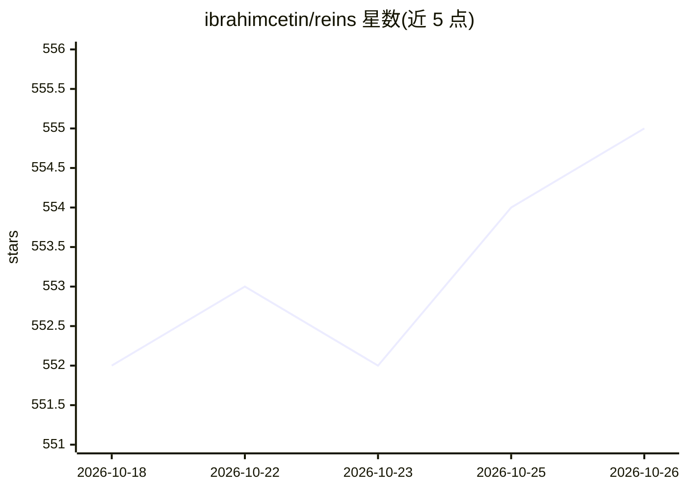

# ibrahimcetin/reins

⭐ 555 · Dart · GPL-3.0 · 推送 2026-10-14 · [GitHub](https://github.com/ibrahimcetin/reins) · [官网](https://getreins.app) · 个人维护

**面向苹果设备的本地 AI 聊天应用：连接本地服务器或端侧运行模型**

iPhone/iPad/Mac 平台的私有 AI 聊天应用，无登录与数据收集，聊天记录保存在设备本地。支持连接 Ollama、LM Studio、Ollama Cloud 或任意 OpenAI 兼容服务器，也可在设备上直接运行 MLX 模型与 Apple Foundation Models，并可通过局域网共享给其他设备。每个会话可独立设置模型、系统提示词、温度与上下文长度；支持工具调用与无需 API key 的网页搜索、多模态附件、思维链模式、会话分支与导出。通过 App Store 分发，仓库源码更新至 1.3.4 版本。

## 筛选速览

| 维度 | 判定 | 备注 |
|---|---|---|
| AI 角色 | `ai-native` | 本体是模型或模型工具 |
| 许可风险 | `viral` | GPL-3.0 |
| 部署形态 | `None` |  |
| 模型依赖 | local-ok | 支持本地模型 |
| 硬件要求 | — | 无带数字的原话,不猜 |
| 安装摩擦 | `low` | 无编译、无系统依赖或容器化 |
| 成熟度 | — | 结构信号不足 |

## 能力要点

- 连接 Ollama、LM Studio、Ollama Cloud 或任意 OpenAI 兼容服务器
- 设备端运行 MLX 模型与 Apple Foundation Models，可局域网共享
- 无需 API key 的工具调用与网页搜索、多步推理
- 每个会话独立的模型、系统提示词与参数配置

## 适用场景

- 在苹果设备上与本地部署的模型聊天，数据不出设备
- 不搭服务器，直接在手机上运行 MLX 模型
- 为不同会话配置不同模型和系统提示词

## 场景标签

`聊天机器人` · 领域:对话与助手

## 证据(README 行号)

> L16: Reins is a private AI chat app for iPhone, iPad and Mac. It connects to your Ollama, LM Studio or OpenAI-compatible
> L22: - **Any server or On-Device:** Connect to Ollama, LM Studio, Ollama Cloud or any OpenAI-compatible server. You can 
> L18: No login. No data collection. Your chats stay on your device.

## 星数曲线

2026-10-18 552 → 2026-10-26 555（+3）

---
*卡片 v1 · prompt 1.4 · 生成 2026-10-21 · 置信度 high · 依据 README sha `8ac80c27945a` · [字段定义](../../DATASET.md)*
