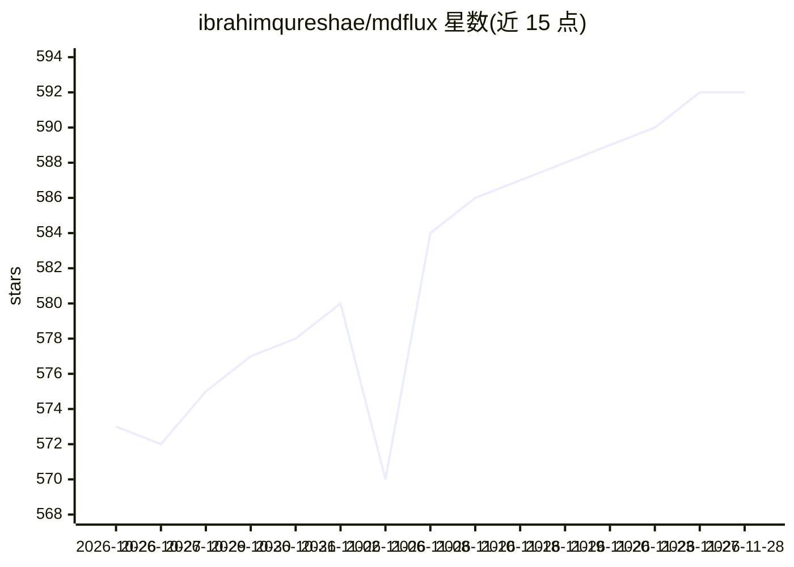

# ibrahimqureshae/mdflux

⭐ 592 · Python · MIT · 推送 2026-11-16 · [GitHub](https://github.com/ibrahimqureshae/mdflux) · [官网](https://ibrahimqureshae.github.io/mdflux/) · 个人维护

**本地桌面工具：把文档批量转成供 LLM 使用的 Markdown**

基于 Microsoft MarkItDown 构建的桌面应用，将 PDF、Office、EPUB、HTML、音频等格式转换为结构化 Markdown；对扫描版 PDF 提供内置 OCR，支持整目录批量转换与进度取消。提供 Off/规则/AI 三种可选清理模式（AI 可走本地或 DeepSeek/OpenAI/Groq 等 API），Changes 页逐行显示清理增删。以便携安装包分发（Windows/Linux x64），分 Lite 与 Full 两个版本，首次启动联网配置私有 Python 环境后可完全离线运行。

## 筛选速览

| 维度 | 判定 | 备注 |
|---|---|---|
| AI 角色 | `ai-enhanced` | 去掉 AI 部分产品仍成立 |
| 许可风险 | `permissive` | MIT |
| 部署形态 | `desktop` | 安装包/桌面程序 |
| 模型依赖 | — | README 未给出锁定关系 |
| 硬件要求 | — | 无带数字的原话,不猜 |
| 安装摩擦 | `medium` | 含编译或系统依赖之一 |
| 成熟度 | — | 结构信号不足 |

## 能力要点

- 内置 OCR 读取扫描/纯图像 PDF，本地恢复文本
- 批量转换整个文件夹，带进度、取消与逐文件诊断
- 清理模式可选 Off、规则或 AI（本地或 API），Changes 页显示增删内容
- Lite/Full 双版本分发，Full 捆绑运行时可离线使用

## 适用场景

- 为 RAG 管道准备干净的结构化源文档
- 批量把论文、报告和扫描存档转成可检索的 Markdown
- 敏感文件不出本机的离线文档转换
- 从二进制办公文档导出可 diff、可版本管理的文本

## 场景标签

`OCR` `文档解析` · 领域:知识与检索

## 证据(README 行号)

> L67: MDFlux is what I wanted instead. Drop in a file or a folder and get back clean, structured Markdown, with OCR for t
> L149: 2. Pick a cleanup mode      →   Off, rule-based, or AI (local or API)
> L179: MDFlux is built on Microsoft's MarkItDown, which is a genuinely great conversion library. What MDFlux adds is ever

## 星数曲线

2026-10-26 573 → 2026-11-28 592（+19）

---
*卡片 v1 · prompt 1.4 · 生成 2026-11-25 · 置信度 mid · 依据 README sha `686f035e4dc9` · [字段定义](../../DATASET.md)*
