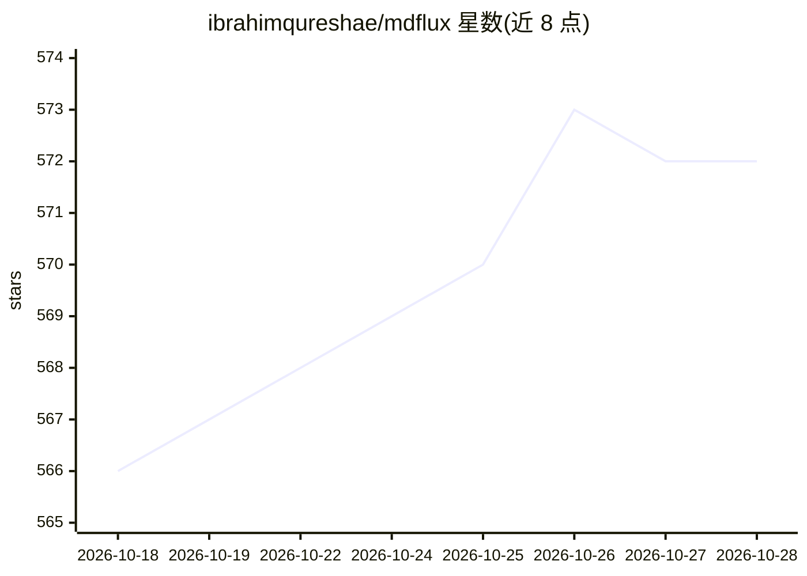

# ibrahimqureshae/mdflux

⭐ 575 · Python · MIT · 推送 2026-10-26 · [GitHub](https://github.com/ibrahimqureshae/mdflux) · [官网](https://ibrahimqureshae.github.io/mdflux/) · 个人维护

**本地优先的桌面文档转 Markdown 工具，含 OCR 与批量转换**

基于 Microsoft MarkItDown 转换引擎的跨平台桌面应用（Windows/Linux x64），将 PDF、Office、EPUB、图像、音频等格式转换为结构化 Markdown，内置 OCR 恢复扫描 PDF 文字，支持整目录批量转换。完全本地运行，无需云端或账号；清理模式可选关闭、规则式或 AI（本地或 API，含 DeepSeek/OpenAI/Groq）。提供 Lite/Full 两种版本，Full 版内置运行时可离线使用。首次启动需联网配置私有 Python 环境。面向 AI/RAG 构建者、研究者与注重隐私的用户。

## 筛选速览

| 维度 | 判定 | 备注 |
|---|---|---|
| AI 角色 | `ai-enhanced` | 去掉 AI 部分产品仍成立 |
| 许可风险 | `permissive` | MIT |
| 部署形态 | `desktop` | 安装包/桌面程序 |
| 模型依赖 | locked-api |  |
| 硬件要求 | — | 无带数字的原话,不猜 |
| 安装摩擦 | `medium` | 含编译或系统依赖之一 |
| 成熟度 | — | 结构信号不足 |

## 能力要点

- 内置 OCR 恢复扫描/纯图像 PDF 的文字
- 整目录批量转换，含进度、取消与逐文件诊断
- 完全本地运行，文档不出本机
- 支持 PDF/DOCX/PPTX/XLSX/EPUB/HTML/图像/音频等格式

## 适用场景

- 把扫描 PDF 批量转成可搜索的 Markdown 存档
- 为 RAG 管线准备干净、省 token 的源文档
- 在不上传敏感文件的前提下转换合同与报告

## 场景标签

`OCR` `文档解析` · 领域:知识与检索

## 证据(README 行号)

> L67: MDFlux is what I wanted instead. Drop in a file or a folder and get back clean, structured Markdown, with OCR for t
> L111: |🧹 **Optional cleanup**|Off, rule-based, or an AI pass (local or API). The **Changes** tab shows what cleanup adde
> L128: - **AI cleanup:** pick DeepSeek, OpenAI, Groq, or another provider in Diagnostics, then Test the key.

## 星数曲线

2026-10-18 566 → 2026-10-28 572（+6）

---
*卡片 v1 · prompt 1.4 · 生成 2026-10-21 · 置信度 mid · 依据 README sha `e53f05bca339` · [字段定义](../../DATASET.md)*
