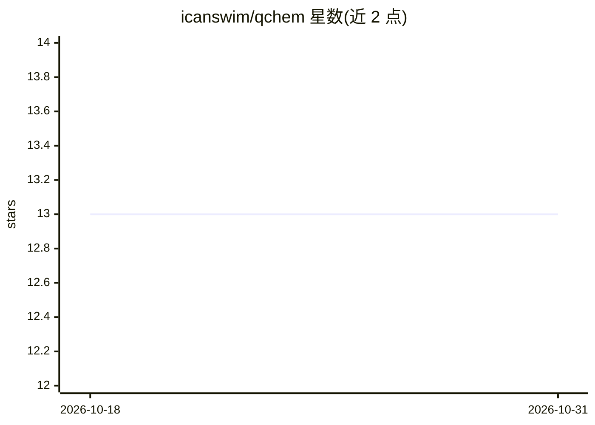

# icanswim/qchem

⭐ 13 · Jupyter Notebook · MIT · 推送 2026-10-30 · [GitHub](https://github.com/icanswim/qchem) · 个人维护

**量子化学分子建模框架：PyTorch 实现数据集、模型与学习器**

面向分子建模的轻量级框架，用 PyTorch 直接实现数据集、模型（含几何深度学习/图神经网络）与学习器组件，集成机器学习、几何深度学习与化学信息学库；核心栈为 pytorch 2.12、torch-geometric 2.8.1、cuda 12.6、python 3.12、rdkit、scikit-learn，并集成作者的 cosmosis 数据科学仓库用于快速原型。提供 uv/conda 环境配置与 experiment.ipynb 示例，README 附大量文献、化学 ML 库与量子化学数据集索引（QM7-X、ANI-1x、Alchemy、QMugs 等）。

## 筛选速览

| 维度 | 判定 | 备注 |
|---|---|---|
| AI 角色 | `ai-native` | 本体是模型或模型工具 |
| 许可风险 | `permissive` | MIT |
| 部署形态 | `library` | 以包/库形式分发 |
| 模型依赖 | — | README 未给出锁定关系 |
| 硬件要求 | — | 无带数字的原话,不猜 |
| 安装摩擦 | `medium` | 含编译或系统依赖之一 |
| 成熟度 | — | 结构信号不足 |

## 能力要点

- 以 PyTorch 直接实现分子数据集、模型与学习器，模块化可扩展
- 核心栈：torch-geometric、rdkit、scikit-learn、CUDA 12.6
- 内置 uv 与 conda 环境配置，experiment.ipynb 提供实现示例
- 索引多个量子化学数据集（QM7-X、ANI-1x、Alchemy、QMugs 等）与文献

## 适用场景

- 我在做分子性质预测，需要一个集成数据集与 GNN 模型的 PyTorch 框架
- 我在探索机器学习近似量子化学方法，需要参考实现与数据集入口
- 我需要模块化的分子建模代码基础来扩展自己的模型

## 场景标签

 · 领域:计算化学/机器学习

## 证据(README 行号)

> L3: A framework for molecular modeling. This framework combines the most powerful open-source libraries for machine lear
> L10: * Implements datasets, models, and learners directly in **PyTorch**.

## 星数曲线

2026-10-18 13 → 2026-10-31 13（+0）

---
*卡片 v1 · prompt 1.4 · 生成 2026-10-31 · 置信度 mid · 依据 README sha `84d98de8d55c` · [字段定义](../../DATASET.md)*
