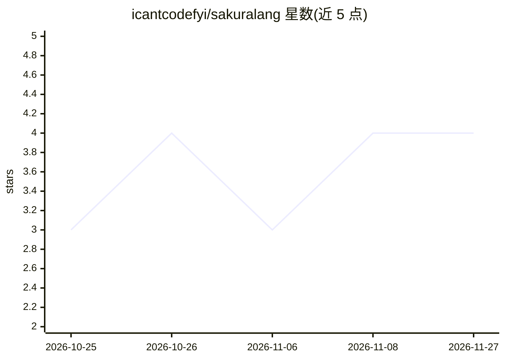

# icantcodefyi/sakuralang

⭐ 4 · Rust · Apache-2.0 · 推送 2026-10-31 · [GitHub](https://github.com/icantcodefyi/sakuralang) · [官网](https://www.sakuralang.com) · 个人维护

**面向 AI agent 的编程语言：签名即契约，编译器给结构化反馈**

Sakura Lang 是一种 agent-first 编程语言：函数签名声明效果（effects）、错误与契约（requires/ensures），编译器用 Rust 编写，目标为 JavaScript 与 WebAssembly。契约在每次构建时运行时检查，可通过 `sakura verify` 调用 Z3（可交叉验证 cvc5）证明。面向人类与 agent 协作开发：`sakura mcp serve` 暴露 check/apply_patch/test 等工具，`--json` 输出版本化诊断，typed holes 报告期望类型与候选。文件/网络/时钟等权限需在 sakura.toml 中显式授予。native 后端与 packages 为实验性。

## 筛选速览

| 维度 | 判定 | 备注 |
|---|---|---|
| AI 角色 | `ai-ecosystem` | LLM/agent 周边工具 |
| 许可风险 | `permissive` | Apache-2.0 |
| 部署形态 | `library` | 以包/库形式分发 |
| 模型依赖 | — | README 未给出锁定关系 |
| 硬件要求 | — | 无带数字的原话,不猜 |
| 安装摩擦 | `low` | 无编译、无系统依赖或容器化 |
| 成熟度 | `idea` | |

## 能力要点

- 签名声明效果、错误与契约，编译器做类型与效果检查
- 契约可用 SMT 求解器（Z3/cvc5）证明
- 内置 MCP server 与 agent skill 安装（claude/codex/cursor）
- 权限系统：文件/网络/时钟/随机性均为显式 effect

## 适用场景

- 让编码 agent 在契约约束下做小改动并获得结构化反馈
- 需要确定性测试的场景（固定时钟、种子化随机、禁网）
- 教学或研究效果系统与契约验证

## 场景标签

 · 领域:编程语言/开发工具

## 证据(README 行号)

> L7:  AGENT-FIRST The programming language built for agents.
> L14: Sakura Lang is an **agent-first programming language** built around explicit,
> L95: - **Built for agents.** `sakura setup` installs a skill and MCP entry; `sakura mcp serve`

## 星数曲线

2026-10-25 3 → 2026-11-27 4（+1）

---
*卡片 v1 · prompt 1.4 · 生成 2026-11-21 · 置信度 high · 依据 README sha `daee1f22d9a5` · [字段定义](../../DATASET.md)*
