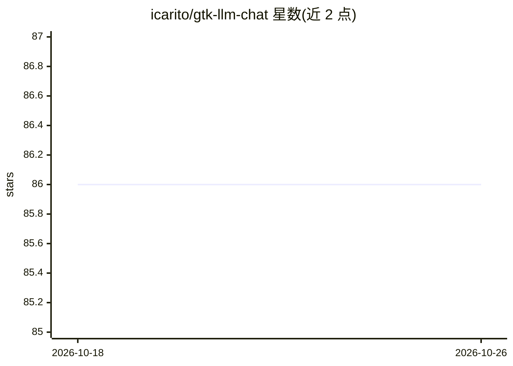

# icarito/gtk-llm-chat

⭐ 86 · Python · GPL-3.0 · 推送 2026-10-13 · [GitHub](https://github.com/icarito/gtk-llm-chat) · [官网](https://gtk-llm-chat.fuentelibre.org/) · 个人维护

**与 LLM 对话的 GTK 桌面图形客户端**

基于 GTK4/libadwaita 的桌面聊天界面，作为命令行工具 llm 的图形前端运行：通过 python-llm 接入多种模型，支持多会话独立窗口、流式响应、Markdown 渲染、按会话调整温度与系统提示词、按提供商管理 API key，也可作为 llm 插件安装（llm install gtk-llm-chat）。提供 Windows 安装器、Linux AppImage 与 macOS 应用包；亦可从源码运行，系统依赖包括 GTK 4.0、libadwaita 与 Python 3.8+。以 GPLv3 发布。

## 筛选速览

| 维度 | 判定 | 备注 |
|---|---|---|
| AI 角色 | `ai-native` | 本体是模型或模型工具 |
| 许可风险 | `viral` | GPL-3.0 |
| 部署形态 | `library` | 以包/库形式分发 |
| 模型依赖 | — | README 未给出锁定关系 |
| 硬件要求 | — | 无带数字的原话,不猜 |
| 安装摩擦 | `medium` | 含编译或系统依赖之一 |
| 成熟度 | — | 结构信号不足 |

## 能力要点

- llm 命令行工具的图形前端，接入多种 LLM 模型
- 多会话独立窗口、流式响应与 Markdown 渲染
- 按提供商管理 API key，按会话设置温度与系统提示词
- 提供 Windows 安装器、Linux AppImage 与 macOS 应用包

## 适用场景

- 在桌面环境用图形界面与各类 LLM 对话
- 替代命令行方式使用 llm 工具进行日常任务
- 并行管理多个独立会话窗口

## 场景标签

`聊天机器人` · 领域:对话与助手

## 证据(README 行号)

> L3: A GTK graphical interface for chatting with Large Language Models (LLMs).
> L37: **Gtk-LLM-Chat** is a graphical frontend for the command-line llm utility. Just as `llm` integrates large language 

## 星数曲线

2026-10-18 86 → 2026-10-26 86（+0）

---
*卡片 v1 · prompt 1.4 · 生成 2026-10-24 · 置信度 high · 依据 README sha `0c844d580948` · [字段定义](../../DATASET.md)*
