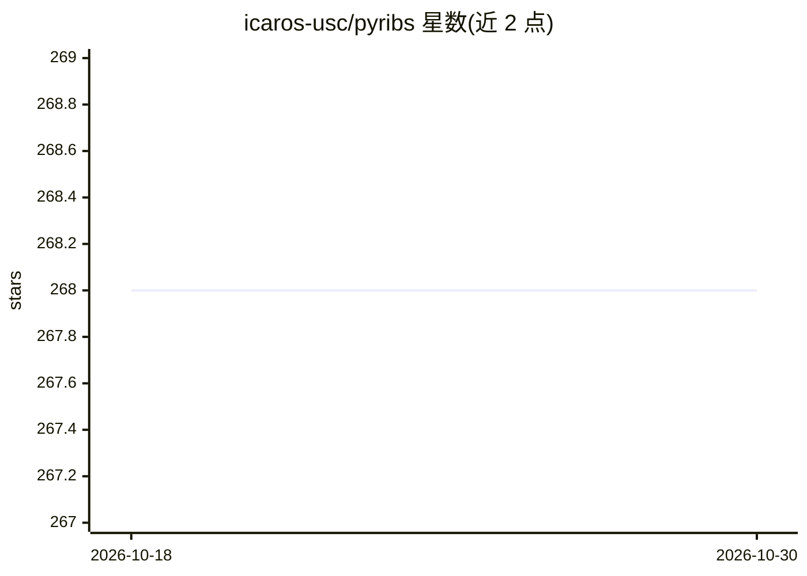

# icaros-usc/pyribs

⭐ 268 · Python · MIT · 推送 2026-07-22 · [GitHub](https://github.com/icaros-usc/pyribs) · [官网](https://pyribs.org) · 组织维护

**质量多样性（QD）优化的 Python 库，面向科研与算法开发者**

实现模块化 RIBS 框架的质量多样性优化库，将 QD 算法拆分为 archive、emitter、scheduler 三个可替换组件，通过 ask/tell 接口运行，支持 CMA-ME、CMA-MEGA、CMA-MAE、可扩展 CMA-MAE 与 Discount Model Search 等算法的官方实现，输出 measure 空间的热图存档。聚焦固定维度连续域优化，提供 Matplotlib 可视化工具与 Conda/源码安装选项，用户包括 USC、Google DeepMind、华为诺亚方舟实验室等研究团队，配有论文与教程文档。

## 筛选速览

| 维度 | 判定 | 备注 |
|---|---|---|
| AI 角色 | `ai-native` | 本体是模型或模型工具 |
| 许可风险 | `permissive` | MIT |
| 部署形态 | `library` | 以包/库形式分发 |
| 模型依赖 | — | README 未给出锁定关系 |
| 硬件要求 | — | 无带数字的原话,不猜 |
| 安装摩擦 | `low` | 无编译、无系统依赖或容器化 |
| 成熟度 | — | 结构信号不足 |

## 能力要点

- archive/emitter/scheduler 三组件可组合的 RIBS 框架
- CMA-ME、CMA-MAE 等多种 QD 算法的官方实现
- ask/tell 接口（沿用 pycma 风格）与存档热图可视化
- 配套论文（GECCO 2023）与教程文档

## 适用场景

- 在连续参数空间上运行质量多样性优化并生成行为空间热图
- 科研中实现与修改新的 QD 算法
- 用预置组件组合不同 QD 算法做实验

## 场景标签

`科研工具` · 领域:学习与行业

## 证据(README 行号)

> L15: A _bare-bones_ Python library for quality diversity (QD) optimization. Pyribs
> L18: Covariance Matrix Adaptation MAP-Elites (CMA-ME), Covariance Matrix Adaptation
> L55: Pyribs is an implementation of the RIBS framework designed to support a wide

## 星数曲线

2026-10-18 268 → 2026-10-30 268（+0）

---
*卡片 v1 · prompt 1.4 · 生成 2026-10-22 · 置信度 high · 依据 README sha `b60507aec247` · [字段定义](../../DATASET.md)*
