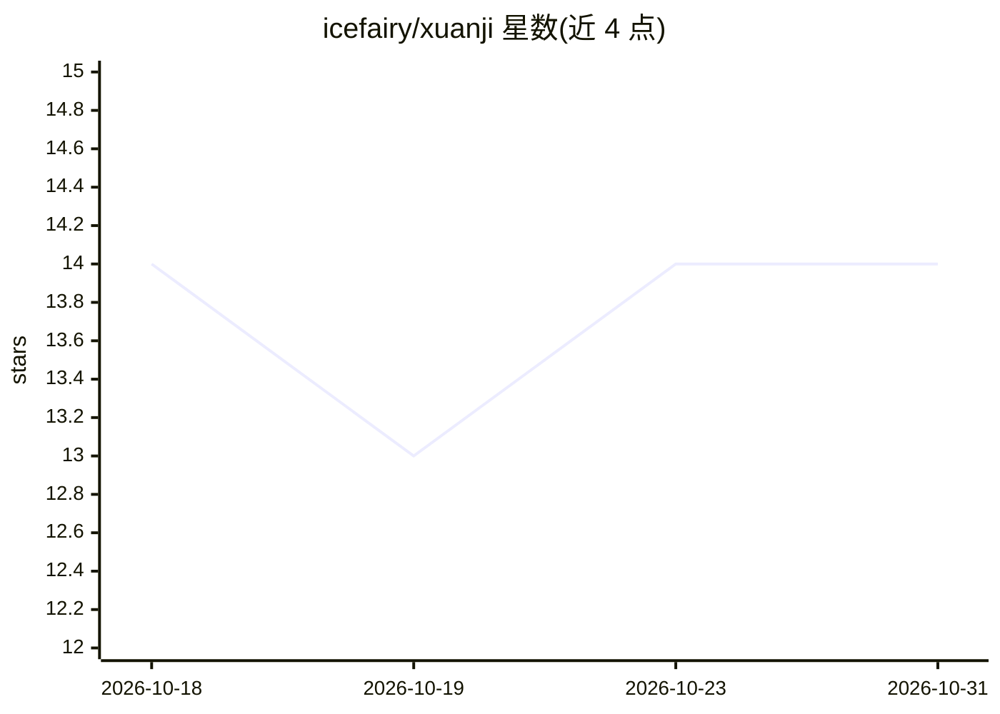

# icefairy/xuanji

⭐ 14 · JavaScript · Apache-2.0 · 推送 2026-10-30 · [GitHub](https://github.com/icefairy/xuanji) · [官网](https://github.com/icefairy/xuanji) · 个人维护 · 中文 README

**Go 单二进制 AI 网关：OpenAI/Anthropic 双协议上游汇聚与成本分流**

面向个人与小团队自用的轻量 LLM 网关：以单二进制 + SQLite 形式提供，汇聚多家上游（硅基流动、商汤、DeepSeek 中转、vLLM、OpenRouter、Ollama 等），OpenAI 与 Anthropic 双协议原生入口，Claude Code 可直接接入。核心机制包括成本优先路由（计费层级→权重→优惠时段→延迟）、失败自动切换与熔断、思考深度参数归一化、时间线注入、Vue 管理界面热重载配置。无计费/用户管理/配额兑换等运营功能。安装方式为 go build 源码构建、Docker compose 或 Supervisor 裸机部署。

## 筛选速览

| 维度 | 判定 | 备注 |
|---|---|---|
| AI 角色 | `ai-ecosystem` | LLM/agent 周边工具 |
| 许可风险 | `permissive` | Apache-2.0 |
| 部署形态 | `self-host` | docker 或自建部署 |
| 模型依赖 | local-ok | 支持本地模型 |
| 硬件要求 | — | 无带数字的原话,不猜 |
| 安装摩擦 | `low` | 无编译、无系统依赖或容器化 |
| 成熟度 | — | 结构信号不足 |

## 能力要点

- OpenAI + Anthropic 双协议原生入口，流式 SSE 逐行透传
- 成本优先路由：计费层级→权重→优惠时段→延迟四级排序，失败自动升级切换
- 思考深度归一化：下游统一传 reasoning_effort，网关按模型族自动翻译
- Go 单二进制 + SQLite 零外部依赖，配置 CRUD 即热重载

## 适用场景

- 为 Claude Code、OpenCode 等 AI 工具提供统一的多上游接入入口
- 按成本优先级在免费/包月/按量上游间自动分流控制开销
- 个人或小团队按 API Key 统计各 AI 程序的用量与费用

## 场景标签

`模型网关` · 领域:Agent 开发

## 证据(README 行号)

> L12: > **OpenAI / Anthropic 协议汇聚 · 负载 · 分流网关**
> L18: **它是 one-api / new-api / LiteLLM / Portkey / Kong AI Gateway 等网关的轻量替代品**：同样解决"多家上游统一入口、API Key 管理、成本控制、故障切换"，但体积、依赖
> L361: ## 与同类项目对比

## 星数曲线

2026-10-18 14 → 2026-10-31 14（+0）

---
*卡片 v1 · prompt 1.4 · 生成 2026-10-31 · 置信度 high · 依据 README sha `c5385ea3e248` · [字段定义](../../DATASET.md)*
