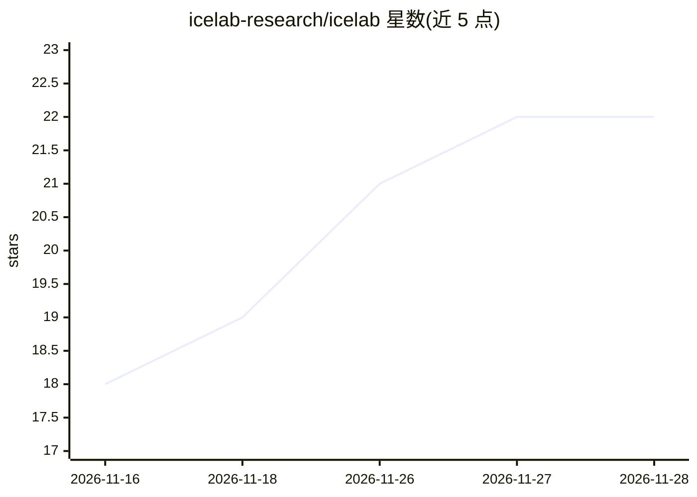

# icelab-research/icelab

⭐ 22 · JavaScript · 推送 2026-11-26 · [GitHub](https://github.com/icelab-research/icelab) · [官网](https://icelab.sh) · 组织维护

**RaidZero 媒体可观测性产品的多语言客户端 SDK 集合**

Ice Lab 维护的 RaidZero 媒体可观测性产品的官方 SDK 仓库，提供 TypeScript、Python、Rust、Go、Java、Kotlin、Elixir 共 7 种语言的客户端库（均 0.2.1 版本），另有仅源码形式的 C++ helper 与独立 Go module 的可观测性 helper。仓库通过自动化源码导出维护，接受 issue 与 PR，采纳后并入后续导出。各 SDK 目录内含 API、安装与构建说明。

## 筛选速览

| 维度 | 判定 | 备注 |
|---|---|---|
| AI 角色 | `ai-enhanced` | 去掉 AI 部分产品仍成立 |
| 许可风险 | `none` | — |
| 部署形态 | `library` | 以包/库形式分发 |
| 模型依赖 | — | README 未给出锁定关系 |
| 硬件要求 | — | 无带数字的原话,不猜 |
| 安装摩擦 | `low` | 无编译、无系统依赖或容器化 |
| 成熟度 | — | 结构信号不足 |

## 能力要点

- 7 种语言官方客户端库，统一版本 0.2.1
- C++ helper 为仅源码形式，Go 可观测性 helper 为独立 module
- 通过自动化源码导出维护，接受 issue 与 PR

## 适用场景

- 在自己的应用中接入 RaidZero 媒体可观测性服务
- 查阅各语言 SDK 的 API 与安装构建说明

## 场景标签

 · 领域:媒体可观测性/开发者工具

## 证据(README 行号)

> L3: Client libraries for RaidZero, a media observability product by Ice Lab.

## 星数曲线

2026-11-16 18 → 2026-11-28 22（+4）

---
*卡片 v1 · prompt 1.4 · 生成 2026-11-18 · 置信度 low · 依据 README sha `3848131e8bb9` · [字段定义](../../DATASET.md)*
