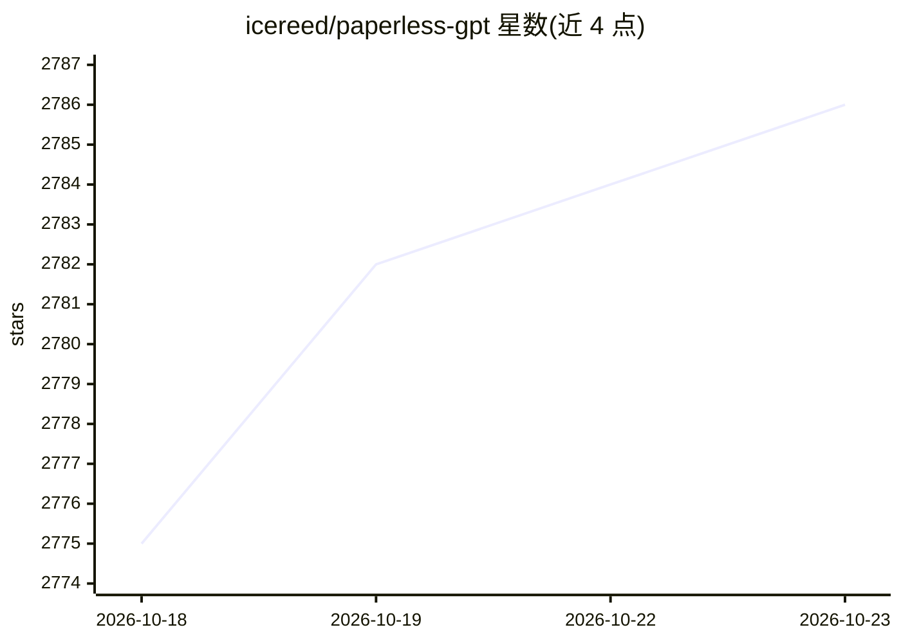

# icereed/paperless-gpt

⭐ 2,786 · Go · MIT · 推送 2026-10-20 · [GitHub](https://github.com/icereed/paperless-gpt) · 个人维护

**给 paperless-ngx 用户的 AI 文档处理工具：LLM OCR 与自动标题标签生成**

与 paperless-ngx 配合使用的自托管服务，用 LLM 或专业 OCR 服务（Azure Document Intelligence、Google Document AI、Docling Server）提取文档文本，并自动生成标题、标签、创建日期、往来单位与自定义字段。支持按引用编号把提醒、修正案、信件与对应发票/合同互相关联，生成带透明文本层的可搜索 PDF。提供 Web UI 人工审核与自动处理两种模式。以 Docker Compose 或源码手动构建部署，无内置鉴权，需反向代理保护。

## 筛选速览

| 维度 | 判定 | 备注 |
|---|---|---|
| AI 角色 | `ai-native` | 本体是模型或模型工具 |
| 许可风险 | `permissive` | MIT |
| 部署形态 | `self-host` | docker 或自建部署 |
| 模型依赖 | local-ok | 支持本地模型 |
| 硬件要求 | — | 无带数字的原话,不猜 |
| 安装摩擦 | `low` | 无编译、无系统依赖或容器化 |
| 成熟度 | — | 结构信号不足 |

## 能力要点

- LLM 视觉模型 OCR（OpenAI/Ollama），另有 Azure/Google/Docling OCR 后端
- 自动生成标题、标签、创建日期、往来单位与自定义字段
- 按引用编号互相关联相关文档（Document Link）
- 生成带透明文本层的可搜索 PDF 并可作为同一文档的新版本

## 适用场景

- 让 paperless-ngx 自动为扫描文档命名和打标签
- 低质量扫描件用 LLM OCR 提取更准确的文本
- 把发票、催款信、修正案等按引用编号自动关联成档案组

## 场景标签

`OCR` `文档解析` · 领域:知识与检索

## 证据(README 行号)

> L17: **paperless-gpt** seamlessly pairs with [paperless-ngx][paperless-ngx] to generate **AI-powered document titles** a
> L29: 1. **LLM-Enhanced OCR**
> L39:  - **LLM OCR**: Use OpenAI or Ollama to extract text from images.

## 星数曲线

2026-10-18 2,775 → 2026-10-23 2,786（+11）

---
*卡片 v1 · prompt 1.4 · 生成 2026-10-21 · 置信度 high · 依据 README sha `c70140882e4b` · [字段定义](../../DATASET.md)*
