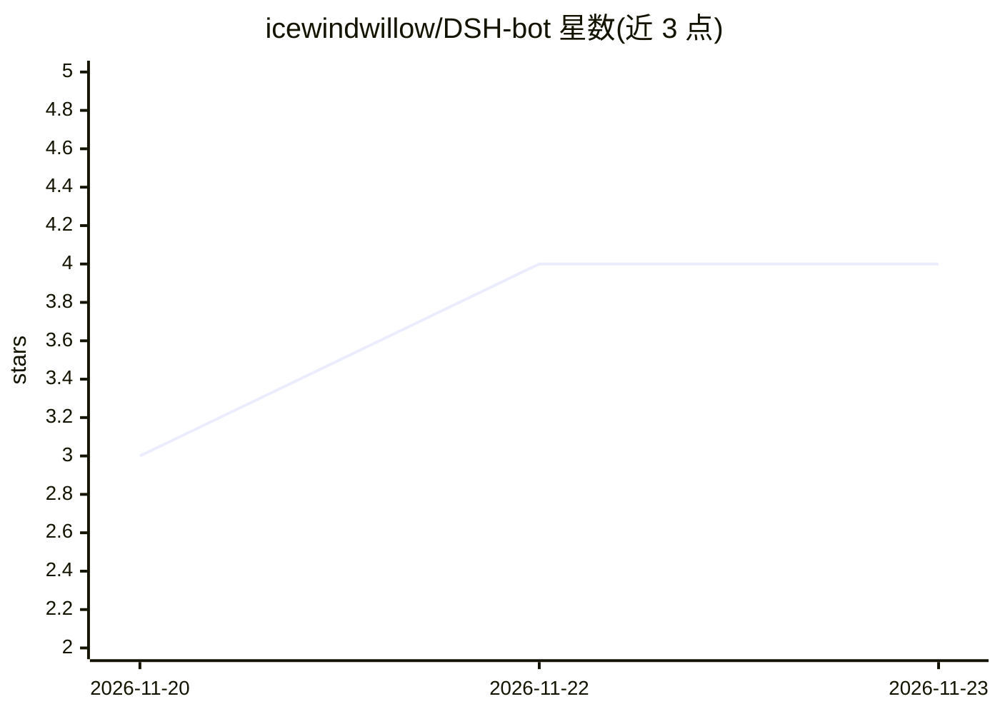

# icewindwillow/DSH-bot

⭐ 4 · JavaScript · MIT · 推送 2026-11-21 · [GitHub](https://github.com/icewindwillow/DSH-bot) · 个人维护 · 中文 README

**QQ 群聊 AI 机器人：带人格、分类记忆与主动提醒**

基于 DeepSeek Harness（DSH）的 QQ 群聊增强项目，QQ 连接与基础会话由上游插件提供，本仓库负责群聊行为、记忆与控制台。核心机制：每条消息经独立记忆门控，按身份、偏好、关系、经历、约定、雷区、梗、近况八类筛选写入长期记忆；事件追踪器记录计划与情绪两条线并做去重与结算；回复模型与判断模型分开配置，用唤醒词与唤醒指数调节参与度。以 Node.js 运行，macOS 部署为主，生图与语音为可选插拔能力，默认关闭。

## 筛选速览

| 维度 | 判定 | 备注 |
|---|---|---|
| AI 角色 | `ai-native` | 本体是模型或模型工具 |
| 许可风险 | `permissive` | MIT |
| 部署形态 | `None` |  |
| 模型依赖 | — | README 未给出锁定关系 |
| 硬件要求 | — | 无带数字的原话,不猜 |
| 安装摩擦 | `low` | 无编译、无系统依赖或容器化 |
| 成熟度 | — | 结构信号不足 |

## 能力要点

- 记忆门控按八类筛选写入长期记忆，带群 scope、主体、日期与来源标签
- 事件追踪计划与情绪两条线，情绪不好时优先关心、事件完成后结算
- 回复模型与判断模型分离，支持按群/按成员配置行为与唤醒指数
- 本地浏览器控制台管理模型、凭据、人格、记忆与图库

## 适用场景

- 在 QQ 群里养一个能记住群友近况并自然接话的机器人
- 让机器人记录群内约定并到点主动提醒
- 按群设置不同人格、语气与话题边界

## 场景标签

`聊天机器人` `Agent 记忆` · 领域:Agent 开发

## 证据(README 行号)

> L9: 小易喵是一个住在 QQ 群里的数字生命。
> L42: **DSH-bot 是 DeepSeek Harness（DSH）的 QQ 群聊增强项目。** QQ 连接和基础会话由 DSH 与上游 `@tencent-connect/dsh-qqbot` 提供；这里负责群聊行为、记忆、控制台

## 星数曲线

2026-11-20 3 → 2026-11-23 4（+1）

---
*卡片 v1 · prompt 1.4 · 生成 2026-11-21 · 置信度 high · 依据 README sha `7b332c922ae7` · [字段定义](../../DATASET.md)*
