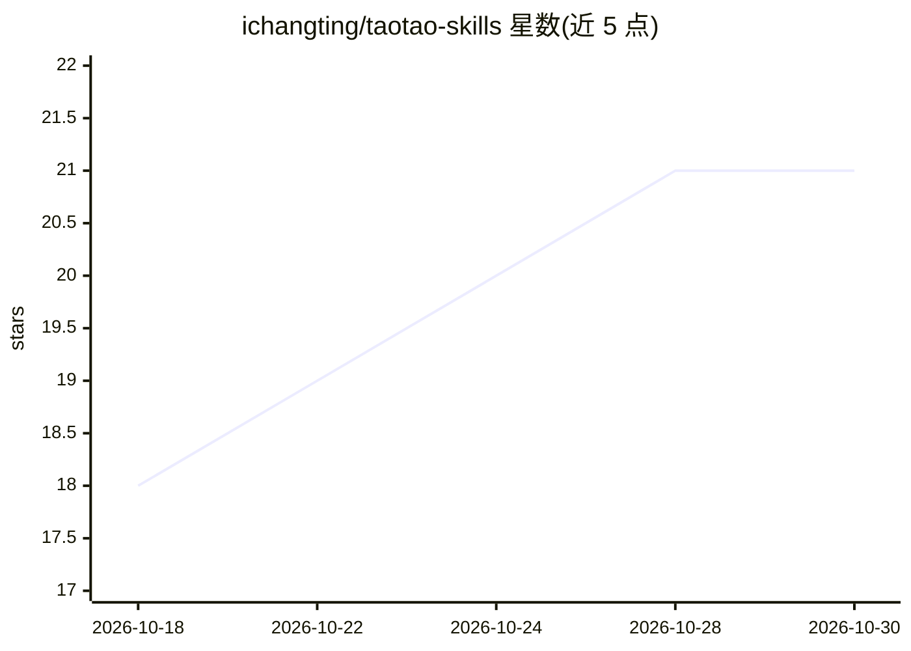

# ichangting/taotao-skills

⭐ 21 · Python · NOASSERTION · 推送 2026-07-28 · [GitHub](https://github.com/ichangting/taotao-skills) · 个人维护 · 中文 README

**初中语文教师的 WorkBuddy AI 教学技能合集（21 个技能）**

一线初中语文教师维护的开源教学技能集合：21 个技能覆盖备课、命题组卷、作文批改、江西中考备考、教研写作、整本书阅读等场景，另含古诗文词汇数据助手、课程标准数据底座及

## 筛选速览

| 维度 | 判定 | 备注 |
|---|---|---|
| AI 角色 | `ai-knowledge` | 知识聚合/清单类 |
| 许可风险 | `none` | NOASSERTION |
| 部署形态 | `None` |  |
| 模型依赖 | — | README 未给出锁定关系 |
| 硬件要求 | — | 无带数字的原话,不猜 |
| 安装摩擦 | `low` | 无编译、无系统依赖或容器化 |
| 成熟度 | — | 结构信号不足 |

## 能力要点

- 21 个技能按备课/命题/批改/备考/教研/名著导读 6 场景组织，教学工作流可自动编排技能链
- 命题组卷对标江西中考卷面结构，输出打印即用 Word 含答案
- 作文批改为教师端参考（维度评分/问题清单/评语草稿），不判分不排名
- 备课助手派生自 Anthropic k12 技能（Apache-2.0），其余为 MIT

## 适用场景

- 让 AI 助手一键生成教案、学生材料与听课模板
- 出周练/期中/中考模拟卷并自动核对文言文字词
- 批改学生作文拿到评分参考与升格示例
- 撰写教研论文并经古文核对与文稿审核把关

## 场景标签

`工作流自动化` `AI 写作` · 领域:效率与自动化

## 证据(README 行号)

> L3: 一线初中语文教师用 AI 助手（WorkBuddy）积累的一套**教学向 Skill（技能）**。
> L101: ### 编排层（L0）

## 星数曲线

2026-10-18 18 → 2026-10-30 21（+3）

---
*卡片 v1 · prompt 1.4 · 生成 2026-10-28 · 置信度 high · 依据 README sha `3983a52f2ba9` · [字段定义](../../DATASET.md)*
