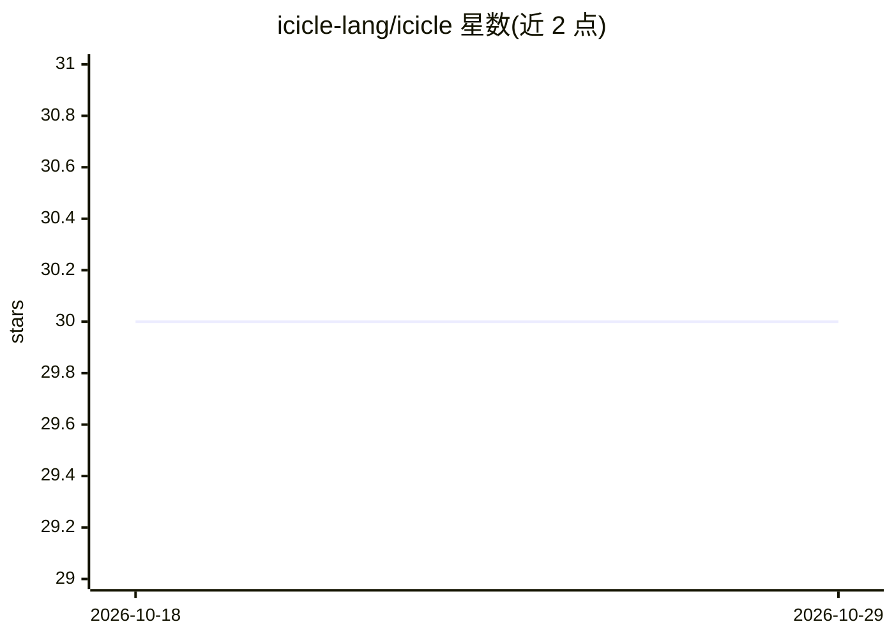

# icicle-lang/icicle

⭐ 30 · Haskell · BSD-3-Clause · 推送 2026-01-20 · [GitHub](https://github.com/icicle-lang/icicle) · 组织维护

**面向数据科学家的流式特征工程查询语言**

Icicle 是一种用于特征工程与商业智能的流式查询语言（DSL），面向数据科学家、数据工程师与 BI 从业者。采用模态类型系统做静态检查，保证查询可通过单遍计算完成、类型检查通过即不会崩溃或互相干扰；通过查询融合与编译到 C 程序的后端进行优化。设计围绕 Fact store：按实体/属性/时间三维存储时序事件，支持流式（如 Kafka consumer）增量计算，用于防止标签泄漏的时间旅行查询。README 未给出安装命令。

## 筛选速览

| 维度 | 判定 | 备注 |
|---|---|---|
| AI 角色 | `ai-ecosystem` | LLM/agent 周边工具 |
| 许可风险 | `permissive` | BSD-3-Clause |
| 部署形态 | `None` |  |
| 模型依赖 | — | README 未给出锁定关系 |
| 硬件要求 | — | 无带数字的原话,不猜 |
| 安装摩擦 | `low` | 无编译、无系统依赖或容器化 |
| 成熟度 | — | 结构信号不足 |

## 能力要点

- 模态类型系统静态保证查询单遍（O(n)）计算
- 查询融合机制，多用户查询可合并执行且互不干扰
- 实体/属性/时间三维组织的 Fact store 数据模型
- 后端将查询编译为操作扁平数据结构的 C 程序

## 适用场景

- 在时序事件数据上构建机器学习特征
- 执行时间旅行查询并防止标签泄漏
- 流式场景下（Kafka consumer）增量计算特征

## 场景标签

 · 领域:数据工程/机器学习基础设施

## 证据(README 行号)

> L8: Icicle is a language designed for easy collaboration in feature
> L16: Icicle is a simple language designed for data scientists, data
> L34: When performing a data engineering and machine learning tasks, one has many

## 星数曲线

2026-10-18 30 → 2026-10-29 30（+0）

---
*卡片 v1 · prompt 1.4 · 生成 2026-10-26 · 置信度 mid · 依据 README sha `0d1193e889fa` · [字段定义](../../DATASET.md)*
