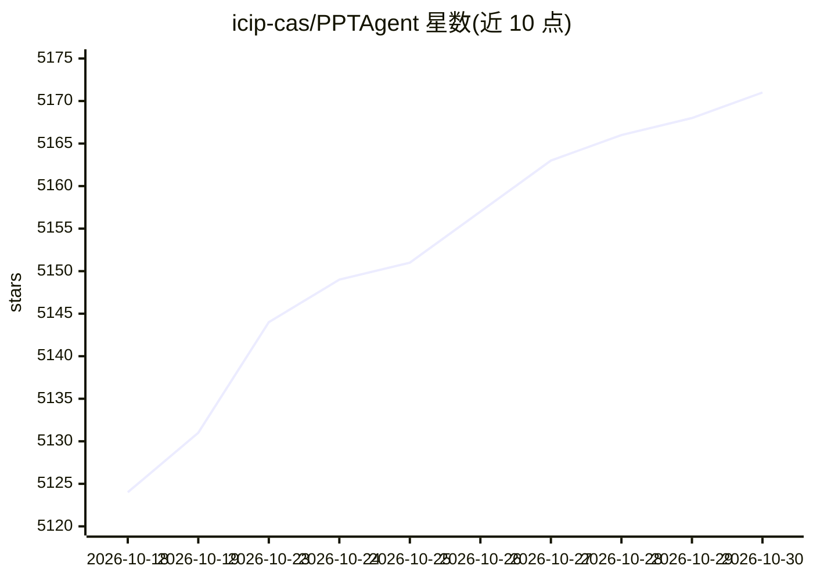

# icip-cas/PPTAgent

⭐ 5,171 · Python · MIT · 推送 2026-10-26 · [GitHub](https://github.com/icip-cas/PPTAgent) · [官网](https://arxiv.org/abs/2501.03936) · 组织维护 · 中文 README

**供编码 Agent 使用的 PowerPoint 生成与视觉审查技能框架**

由中科院软件所等机构维护的 Agentic PPT 生成框架：以技能（Skill）形式接入 Claude Code、Codex CLI 与 OpenCode，让编码代理创建、修改、渲染并视觉审查可编辑的 PPTX 幻灯片，交付 answer.pptx、HTML 源与审查报告。支持 MCP server，可用多模态视觉模型做渲染审阅，示例搭配 Atria Dawn Preview 与 Duanyan 端砚 Token Plan。需 Linux/macOS、uv、npm、LibreOffice（macOS 另需 Chrome）。曾发表 EMNLP 2025 与 ACL 2026 论文并开源。

## 筛选速览

| 维度 | 判定 | 备注 |
|---|---|---|
| AI 角色 | `ai-ecosystem` | LLM/agent 周边工具 |
| 许可风险 | `permissive` | MIT |
| 部署形态 | `library` | 以包/库形式分发 |
| 模型依赖 | — | README 未给出锁定关系 |
| 硬件要求 | — | 无带数字的原话,不猜 |
| 安装摩擦 | `low` | 无编译、无系统依赖或容器化 |
| 成熟度 | — | 结构信号不足 |

## 能力要点

- 技能形式接入 Claude Code / Codex CLI / OpenCode
- 生成、修订、渲染与视觉审查可编辑 PPTX
- 多模态视觉模型作为审查者（OpenAI 兼容 API 配置）
- MCP server 支持（v1.1.37 起记录）

## 适用场景

- 在编码代理会话中直接生成并迭代演示文稿
- 让视觉模型审查渲染后的幻灯片并产出报告
- 获取可编辑的 PPTX 交付物与 HTML 源

## 场景标签

 · 领域:办公文档生成/Agent 工具

## 证据(README 行号)

> L4: > **PPTAgent Skill for Claude Code, Codex & OpenCode Now Available!**
> L31: - **[2025/09]** 🛠️ MCP server support added — see the v1.1.37 documentation for details.
> L38: **Requirements:** Claude Code, Codex CLI, or OpenCode; Linux (including WSL) or macOS; uv; npm; and LibreOffice ava

## 星数曲线

2026-10-18 5,124 → 2026-10-30 5,171（+47）

---
*卡片 v1 · prompt 1.4 · 生成 2026-10-20 · 置信度 mid · 依据 README sha `45a571ea25c2` · [字段定义](../../DATASET.md)*
