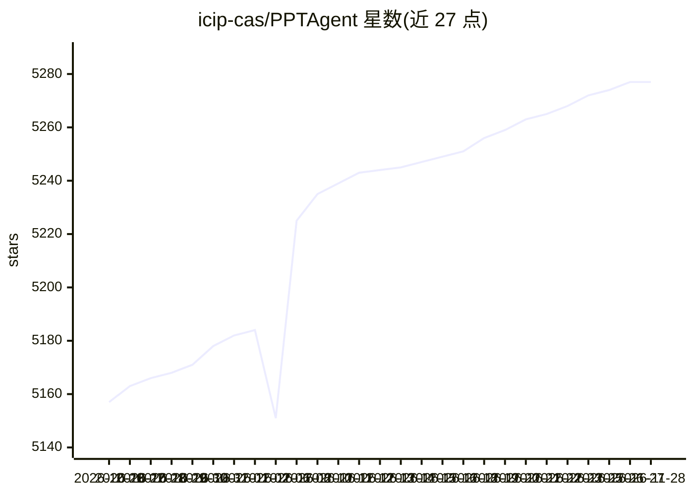

# icip-cas/PPTAgent

⭐ 5,277 · Python · MIT · 推送 2026-11-23 · [GitHub](https://github.com/icip-cas/PPTAgent) · [官网](https://arxiv.org/abs/2501.03936) · 组织维护 · 中文 README

**面向编码 Agent 的 PPT 生成技能：创建、修改并可视化审阅幻灯片**

PPTAgent 是一个反射式演示文稿生成框架，当前形态为可注册到 Claude Code、Codex CLI、OpenCode 的 Skill：用户在编码 Agent 会话中用自然语言创建、修订幻灯片，流程包含渲染截图的多模态视觉审阅（可用 DeepSeek 视觉模型作为审阅器）并导出可编辑的 PPTX。通过 git clone 与 uv 安装，需 Node、LibreOffice 等系统依赖，提供 doctor 自检命令；旧版本对应 EMNLP 2025 与 ACL 2026 两篇论文，另有 MCP server 支持（v1.1.37）。

## 筛选速览

| 维度 | 判定 | 备注 |
|---|---|---|
| AI 角色 | `ai-native` | 本体是模型或模型工具 |
| 许可风险 | `permissive` | MIT |
| 部署形态 | `library` | 以包/库形式分发 |
| 模型依赖 | — | README 未给出锁定关系 |
| 硬件要求 | — | 无带数字的原话,不猜 |
| 安装摩擦 | `low` | 无编译、无系统依赖或容器化 |
| 成熟度 | — | 结构信号不足 |

## 能力要点

- 以 Skill 形式注册进 Claude Code / Codex CLI / OpenCode
- 文本模式写作 + 多模态视觉模型审阅渲染后的幻灯片，支持 OpenAI 兼容接口
- 导出可编辑 PPTX 与 HTML 源文件，保留预览与审阅报告
- 支持 PPTX 导出离线模式、MCP server，附带 sandbox 与 20+ 工具的 Agent 环境（DeepPresenter）

## 适用场景

- 在编码 Agent 里用一句话生成一份可编辑的演示文稿
- 迭代修改幻灯片（如改图表、调页数）并自动视觉校验
- 基于文档素材生成并审查学术或工程汇报幻灯片

## 场景标签

 · 领域:办公自动化/演示文稿生成

## 证据(README 行号)

> L10: > Create, revise, and visually review editable PowerPoint decks with your coding agent.
> L34: - **[2025/12]** 🔥 Released **DeepPresenter** codebase with major upgrades — Deep Research Integration, Free-Form Vi
> L125: Atria writes the slides through the text workflow; `deepseek-v4-flash-vision` reviews the rendered images. The ski

## 星数曲线

2026-10-26 5,157 → 2026-11-28 5,277（+120）

---
*卡片 v1 · prompt 1.4 · 生成 2026-11-22 · 置信度 high · 依据 README sha `64efc17eab3d` · [字段定义](../../DATASET.md)*
