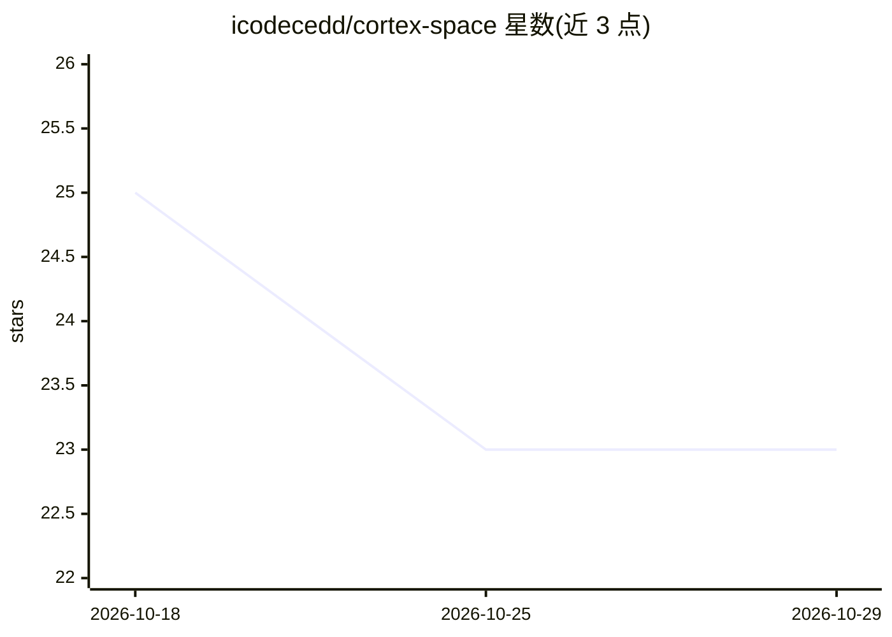

# icodecedd/cortex-space

⭐ 23 · TypeScript · MIT · 推送 2026-06-26 · [GitHub](https://github.com/icodecedd/cortex-space) · [官网](https://cortex-space.vercel.app/) · 个人维护

**本地优先的多面板终端管理器，面向开发者的桌面工作区**

基于 Tauri v2 + Rust 与 React 19/TypeScript 构建的桌面终端管理器，用递归分割布局、拖拽面板重排替代静态终端配置。提供基于 Xterm.js 与 portable-PTY 的多面板终端（支持 PowerShell/Bash/Zsh）、全局命令面板（Ctrl/Cmd+K）、带 {{VAR}} 占位符的命令片段、多工作区与子标签页、localhost 端口自动检测、14 套内置主题与 Zen 模式。CLI 工具注册表可检测 AI agents、语言服务器等工具的安装状态并给出安装命令；拖拽技能到 AI agent 等功能标注为开发中，版本 0.1.3，处于活跃开发阶段。

## 筛选速览

| 维度 | 判定 | 备注 |
|---|---|---|
| AI 角色 | `ai-enhanced` | 去掉 AI 部分产品仍成立 |
| 许可风险 | `permissive` | MIT |
| 部署形态 | `None` |  |
| 模型依赖 | — | README 未给出锁定关系 |
| 硬件要求 | — | 无带数字的原话,不猜 |
| 安装摩擦 | `low` | 无编译、无系统依赖或容器化 |
| 成熟度 | `idea` | |

## 能力要点

- 递归分割布局与拖拽重排的多面板终端（Xterm.js + portable-PTY）
- CLI 工具注册表：检测 AI agents/语言服务器等安装状态并一键安装
- 命令片段支持 {{VAR}} 占位符解析
- 实时解析终端输出中的 localhost URL 并做 TCP 存活检测

## 适用场景

- 用键盘驱动的多面板工作区替代静态终端配置
- 按项目隔离多个终端工作区并持久化布局
- 管理常用命令片段与本地开发端口发现

## 场景标签

 · 领域:开发者工具/桌面终端

## 证据(README 行号)

> L33: **Under Development** -- Cortex Space is a native desktop terminal manager that replaces static terminal configurat
> L45: - **CLI Tool Registry** -- Discover and verify installation status of developer CLI tools (AI agents, language serv

## 星数曲线

2026-10-18 25 → 2026-10-29 23（-2）

---
*卡片 v1 · prompt 1.4 · 生成 2026-10-27 · 置信度 high · 依据 README sha `561a2450694e` · [字段定义](../../DATASET.md)*
