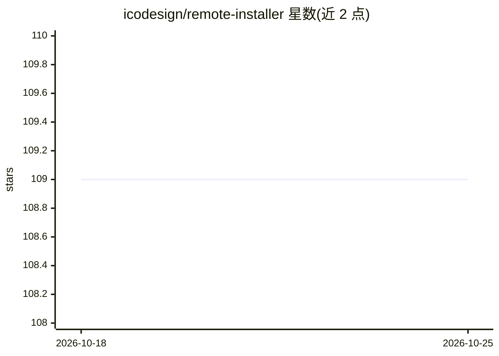

# icodesign/remote-installer

⭐ 109 · Rust · MIT · 推送 2026-09-30 · [GitHub](https://github.com/icodesign/remote-installer) · 个人维护

**通过临时 HTTPS 链接把已签名 iOS/Android 包安装到真机的 CLI 工具**

面向开发者的命令行工具：校验已签名的 .ipa/.app/.apk 构建，通过 Cloudflare Quick Tunnel 或 Tailscale Serve/Funnel 建立临时隧道，生成链接与二维码供手机浏览器直接安装，构建文件保留在本机不上传。支持过期时间、下载次数限制、断点续传进度显示与 launchd 后台共享。不签名、不注册设备、不处理 .aab 或 split APK。附带可供编码 Agent 安装的 skill，发行版目前仅覆盖 macOS arm64/x86_64。

## 筛选速览

| 维度 | 判定 | 备注 |
|---|---|---|
| AI 角色 | `ai-enhanced` | 去掉 AI 部分产品仍成立 |
| 许可风险 | `permissive` | MIT |
| 部署形态 | `library` | 以包/库形式分发 |
| 模型依赖 | — | README 未给出锁定关系 |
| 硬件要求 | — | 无带数字的原话,不猜 |
| 安装摩擦 | `low` | 无编译、无系统依赖或容器化 |
| 成熟度 | — | 结构信号不足 |

## 能力要点

- 校验并分发已签名的 .ipa/.app/.apk，构建保留本机不上传
- 自动发现并启动 Cloudflare Quick Tunnel / Tailscale Serve / Funnel
- 支持 --expire-after、--max-downloads、断点续传与 launchd 后台共享
- 提供可被编码 Agent 安装的 skill（npx skills add）

## 适用场景

- 绕过 TestFlight/Play Beta 把构建直接装到自己的测试机
- AI Agent 完成构建后生成分发链接供真机安装
- 限时限量地把构建分享给同事或外部测试者

## 场景标签

 · 领域:移动开发/构建分发工具

## 证据(README 行号)

> L3: **Install signed iOS and Android builds on real devices over the internet**
> L5: Perfect for AI Agents and vibe coding remotely.
> L95: This repository includes a skill for coding agents:

## 星数曲线

2026-10-18 109 → 2026-10-25 109（+0）

---
*卡片 v1 · prompt 1.4 · 生成 2026-10-23 · 置信度 high · 依据 README sha `73e3792b9e7e` · [字段定义](../../DATASET.md)*
