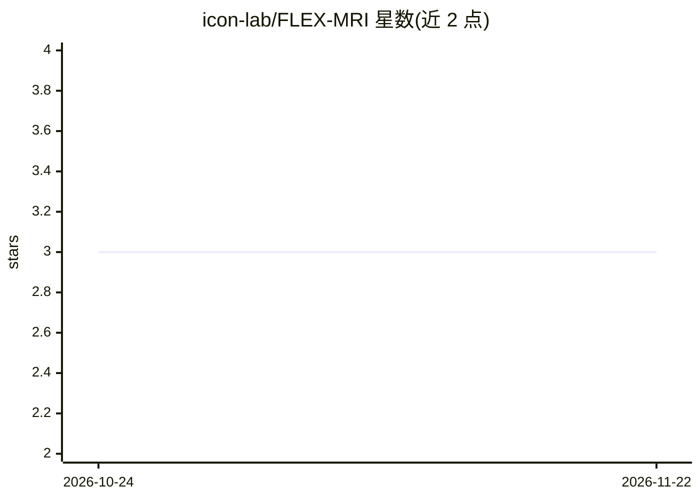

# icon-lab/FLEX-MRI

⭐ 3 · Python · NOASSERTION · 推送 2026-11-16 · [GitHub](https://github.com/icon-lab/FLEX-MRI) · 组织维护

**为科研人员提供加速 MRI 重建的生成式模型官方实现**

FLEX-MRI 的官方 PyTorch 实现，实现论文所述的随机有限转移学习与探索方法：将重建过程划分为由 k-空间支撑渐进变化定义的少量保留状态之间的有限区间，配合随机 k-空间扰动与数据一致性投影，以 J=10 步完成多线圈 MRI 重建。README 给出基于 M4Raw 数据集的训练、重建与 PSNR/SSIM 评估流程，方法核心集中于 utils/finite_transition.py 的 FlexMRI 类，提供消融选项与环境变量覆盖配置。训练需要 CUDA GPU，完整重建扫描约需 40 GB 存储。

## 筛选速览

| 维度 | 判定 | 备注 |
|---|---|---|
| AI 角色 | `ai-native` | 本体是模型或模型工具 |
| 许可风险 | `none` | NOASSERTION |
| 部署形态 | `desktop` | 安装包/桌面程序 |
| 模型依赖 | — | README 未给出锁定关系 |
| 硬件要求 | — | 无带数字的原话,不猜 |
| 安装摩擦 | `medium` | 含编译或系统依赖之一 |
| 成熟度 | — | 结构信号不足 |

## 能力要点

- 方法整体封装于 FlexMRI 类（状态掩码、训练损失、扰动、数据一致性、少步恢复）
- 推理时仅需 10 个转移步骤，无需辅助生成采样器
- 支持可中断续训的检查点与 EMA 权重重建
- 提供受限目标、训练扰动、确定性恢复等消融开关

## 适用场景

- 复现论文中多线圈加速 MRI 重建实验
- 在 M4Raw 多对比度脑部数据上训练少步生成式重建模型
- 对加速倍率 R=2/4/6/8 批量重建并评估 PSNR/SSIM

## 场景标签

`科研工具` · 领域:学习与行业

## 证据(README 行号)

> L3: Official PyTorch implementation of FLEX-MRI as described in the
> L29: generative sampler. Experiments on multi-coil MRI datasets show that FLEX-MRI
> L97: Python 3.9 or newer, and a CUDA GPU for training.

## 星数曲线

2026-10-24 3 → 2026-11-22 3（+0）

---
*卡片 v1 · prompt 1.4 · 生成 2026-11-22 · 置信度 high · 依据 README sha `b3056ba2c58d` · [字段定义](../../DATASET.md)*
