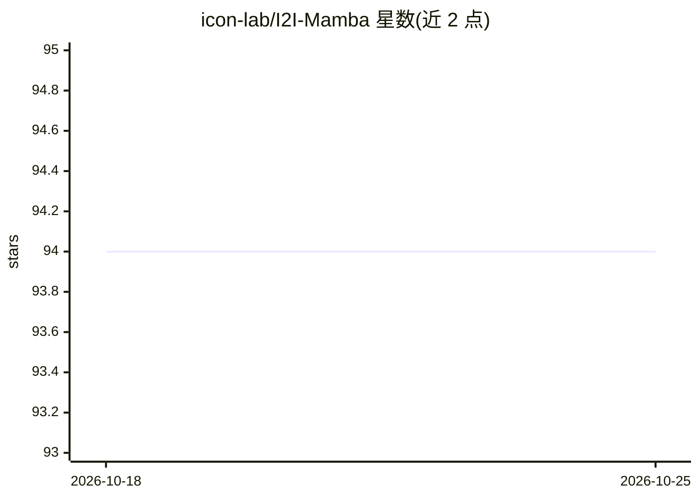

# icon-lab/I2I-Mamba

⭐ 94 · Python · MIT · 推送 2026-02-25 · [GitHub](https://github.com/icon-lab/I2I-Mamba) · 组织维护

**医学多模态图像合成模型 I2I-Mamba 的官方 PyTorch 实现**

I2I-Mamba 是基于选择性状态空间建模（SSM）的对抗性多模态医学图像合成模型，官方以 PyTorch 代码发布。模型在卷积主干瓶颈处注入 cmMamba 块，用 SSM 层学习空间维度上下文、通道混合层学习通道维度上下文，支持一对一到多模态转换。提供数据处理脚本（含螺旋路径生成）、训练与测试命令及参数说明，在 IXI 数据集（T1/T2/PD）上复现论文结果。依赖 Python>=3.8.13 与 CUDA>=11.6，面向使用 GPU 的科研用户。

## 筛选速览

| 维度 | 判定 | 备注 |
|---|---|---|
| AI 角色 | `ai-native` | 本体是模型或模型工具 |
| 许可风险 | `permissive` | MIT |
| 部署形态 | `None` |  |
| 模型依赖 | — | README 未给出锁定关系 |
| 硬件要求 | — | 无带数字的原话,不猜 |
| 安装摩擦 | `medium` | 含编译或系统依赖之一 |
| 成熟度 | — | 结构信号不足 |

## 能力要点

- cmMamba 块嵌入卷积主干瓶颈，捕获长程上下文
- 支持 one-to-one 与 many-to-one 医学图像转换任务
- 提供数据准备、训练、测试的完整脚本与参数说明

## 适用场景

- 复现论文中的多模态医学图像合成实验
- 在自有 MRI 数据上训练跨模态图像转换模型
- 研究 SSM/Mamba 架构在医学影像中的应用

## 场景标签

`图像生成` `多模态` · 领域:内容生成

## 证据(README 行号)

> L20: Official PyTorch implementation of **I2I-Mamba**, a novel adversarial model for multi-modal medical image synthesis
> L140: @article{atli2024i2imamba,

## 星数曲线

2026-10-18 94 → 2026-10-25 94（+0）

---
*卡片 v1 · prompt 1.4 · 生成 2026-10-23 · 置信度 high · 依据 README sha `2af52272ec6d` · [字段定义](../../DATASET.md)*
