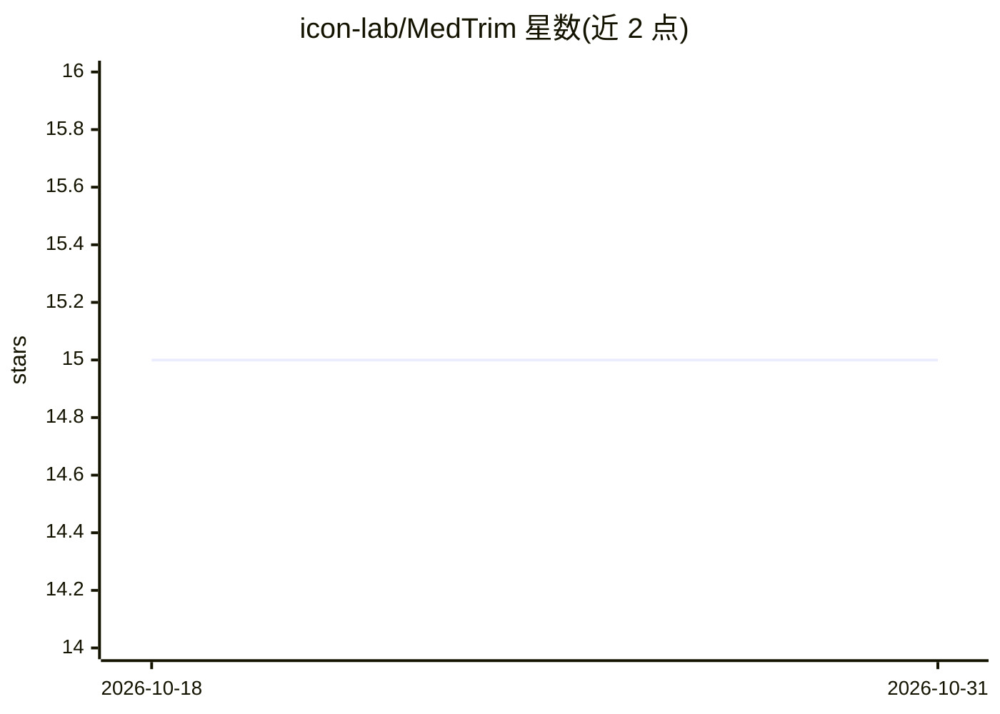

# icon-lab/MedTrim

⭐ 15 · Python · MIT · 推送 2026-03-27 · [GitHub](https://github.com/icon-lab/MedTrim) · 组织维护

**医学影像-报告视觉语言模型对齐的官方 PyTorch 实现**

论文 'Meta-Entity Driven Triplet Mining for Aligning Medical Vision-Language Models' 的官方实现：通过元实体驱动的三元组挖掘（OBER 算法与三元组生成）对齐医学图像与放射报告的表示。流程包括数据集准备、OBER 运行、三元组生成（支持半难样本、阈值与批大小参数）与基于配置文件的模型训练，默认文本编码器为 Bio_ClinicalBERT、图像编码器为 ViT-base。面向科研复现与医学多模态研究，需 conda、CUDA 11.7 与 Python 3.8 环境自行组织数据集。

## 筛选速览

| 维度 | 判定 | 备注 |
|---|---|---|
| AI 角色 | `ai-native` | 本体是模型或模型工具 |
| 许可风险 | `permissive` | MIT |
| 部署形态 | `None` |  |
| 模型依赖 | — | README 未给出锁定关系 |
| 硬件要求 | — | 无带数字的原话,不猜 |
| 安装摩擦 | `medium` | 含编译或系统依赖之一 |
| 成熟度 | — | 结构信号不足 |

## 能力要点

- OBER 算法与可配置三元组生成（阈值/半难样本/双层批大小）
- config.yaml 驱动的训练流程与完整参数表
- 默认文本/图像编码器为 Bio_ClinicalBERT 与 ViT-base

## 适用场景

- 复现论文中的医学视觉语言模型对齐实验
- 在自有影像-报告数据上训练图文检索/零样本分类模型
- 研究三元组挖掘策略对医学多模态表示的影响

## 场景标签

`科研工具` `多模态` · 领域:学习与行业

## 证据(README 行号)

> L4:  Meta-Entity Driven Triplet Mining for Aligning Medical Vision-Language Models
> L6: Official PyTorch implementation of **MedTrim**
> L70: |`--models.text_model`|Pretrained transformer model for text encoding (default: `"emilyalsentzer/Bio_ClinicalBERT"`

## 星数曲线

2026-10-18 15 → 2026-10-31 15（+0）

---
*卡片 v1 · prompt 1.4 · 生成 2026-10-30 · 置信度 high · 依据 README sha `6cdbe917fc59` · [字段定义](../../DATASET.md)*
