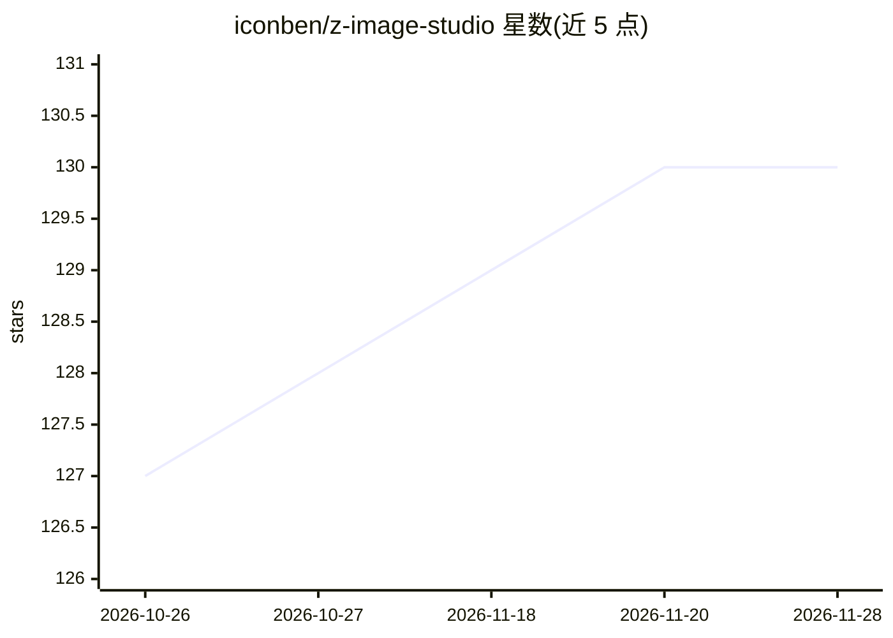

# iconben/z-image-studio

⭐ 130 · Python · Apache-2.0 · 推送 2026-11-04 · [GitHub](https://github.com/iconben/z-image-studio) · 个人维护

**本地运行 Z-Image-Turbo 文生图的 CLI/WebUI/MCP 服务器**

围绕 Tongyi-MAI/Z-Image-Turbo 及其量化模型的本地文生图工具，提供 CLI、FastAPI Web UI 和 MCP 服务器三种形态。针对 NVIDIA CUDA、AMD ROCm（仅 Linux）、Intel XPU、Apple Silicon MPS 做适配，无兼容 GPU 时回退 CPU；含注意力切片自动内存管理、最多 4 个 LoRA 组合、种子控制与历史记录浏览。MCP 服务器支持 stdio/SSE/Streamable HTTP 三种传输，可接入 Claude Desktop、Cline、Gemini CLI 等客户端。需 Python >= 3.11。

## 筛选速览

| 维度 | 判定 | 备注 |
|---|---|---|
| AI 角色 | `ai-native` | 本体是模型或模型工具 |
| 许可风险 | `permissive` | Apache-2.0 |
| 部署形态 | `desktop` | 安装包/桌面程序 |
| 模型依赖 | — | README 未给出锁定关系 |
| 硬件要求 | — | 无带数字的原话,不猜 |
| 安装摩擦 | `low` | 无编译、无系统依赖或容器化 |
| 成熟度 | — | 结构信号不足 |

## 能力要点

- CLI、Web UI、MCP 服务器三种接口，支持 stdio/SSE/Streamable HTTP 传输
- NVIDIA CUDA、AMD ROCm、Intel XPU、Apple Silicon MPS 适配，无 GPU 时回退 CPU
- 最多 4 个 LoRA 逐个设定强度的组合生成
- Web UI 按 RAM/VRAM 动态推荐模型精度并提供分页历史浏览

## 适用场景

- 在本地机器上用 Z-Image-Turbo 生成图片
- 把图片生成作为 MCP 工具接入 AI agent 客户端
- 在 Web UI 中管理 LoRA 并检索历史生成记录
- 无 NVIDIA GPU 的 Mac/AMD/Intel 用户本地文生图

## 场景标签

`图像生成` · 领域:内容生成

## 证据(README 行号)

> L17: A Cli, a webUI, and a MCP server for the **Z-Image-Turbo** text-to-image generation model (`Tongyi-MAI/Z-Image-Turb
> L49: * **MCP Server (stdio + SSE + Streamable HTTP)**: Expose tools for image generation, listing models, and viewing hi

## 星数曲线

2026-10-26 127 → 2026-11-28 130（+3）

---
*卡片 v1 · prompt 1.4 · 生成 2026-11-28 · 置信度 high · 依据 README sha `e42cec35cbbc` · [字段定义](../../DATASET.md)*
