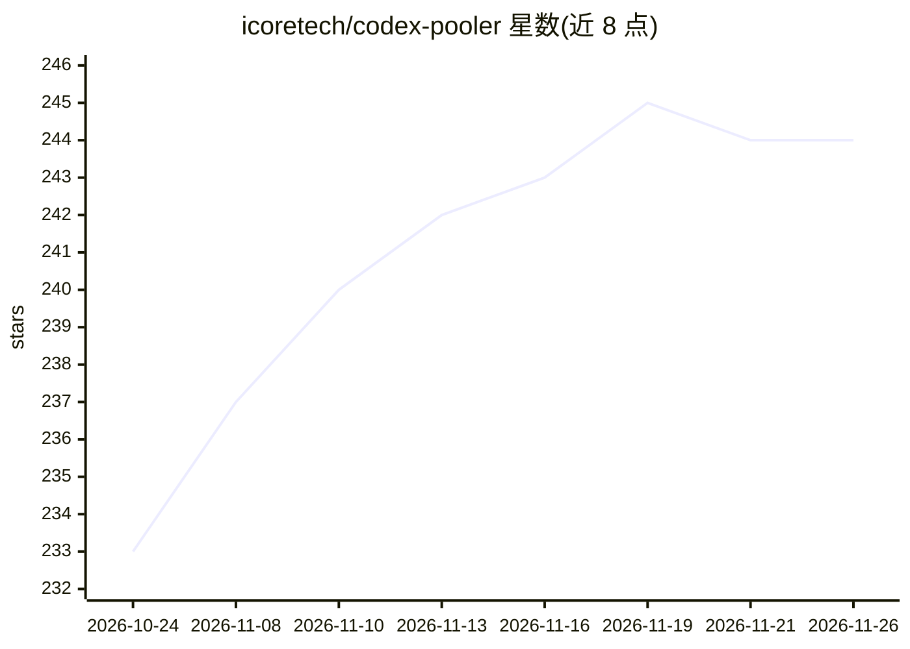

# icoretech/codex-pooler

⭐ 244 · Elixir · NOASSERTION · 推送 2026-11-25 · [GitHub](https://github.com/icoretech/codex-pooler) · [官网](https://codex-pooler.com) · 组织维护

**自托管 Codex 网关：给团队与 agent 提供稳定池化 API 密钥**

Codex Pooler 是面向 Codex 兼容 agent 与 OpenAI 兼容客户端的自托管网关，用单一稳定的 Pool API 密钥替代上游 Codex 账号凭证。网关按模型支持、配额、会话连续性、路由策略与健康状态选择上游账号，提供账号隔离、客户端归一化、请求记账、审计日志、用量限额与保存的重置额度等运维能力。以 Docker Compose 或 Kubernetes 部署，不存储提示词、文件、音频或原始凭证。

## 筛选速览

| 维度 | 判定 | 备注 |
|---|---|---|
| AI 角色 | `ai-ecosystem` | LLM/agent 周边工具 |
| 许可风险 | `none` | NOASSERTION |
| 部署形态 | `self-host` | docker 或自建部署 |
| 模型依赖 | — | README 未给出锁定关系 |
| 硬件要求 | — | 无带数字的原话,不猜 |
| 安装摩擦 | `low` | 无编译、无系统依赖或容器化 |
| 成熟度 | — | 结构信号不足 |

## 能力要点

- 单一 Pool API 密钥在增删上游账号时保持不变
- 缓存感知路由与连接复用，支持 HTTP/SSE 与 WebSockets
- 按模型支持、配额与健康自动选择上游账号
- 支持图像生成/编辑与语音转录经由同一 Pool 密钥

## 适用场景

- 团队共享多个 Codex 账号并统一发放 API 密钥
- 为多个编码 agent 与 IDE 工具提供统一接入点
- 管理密钥用量限额、审计日志与账号容量告警

## 场景标签

`模型网关` · 领域:Agent 开发

## 证据(README 行号)

> L71: Codex Pooler is a self-hosted gateway for running Codex-compatible agents,
> L77: Clients send familiar Codex backend or OpenAI-compatible requests; Codex Pooler
> L127: - 🐳 **Run it on your own infrastructure:** start with Docker Compose or deploy

## 星数曲线

2026-10-24 233 → 2026-11-26 244（+11）

---
*卡片 v1 · prompt 1.4 · 生成 2026-11-25 · 置信度 high · 依据 README sha `b9daf150f9fe` · [字段定义](../../DATASET.md)*
