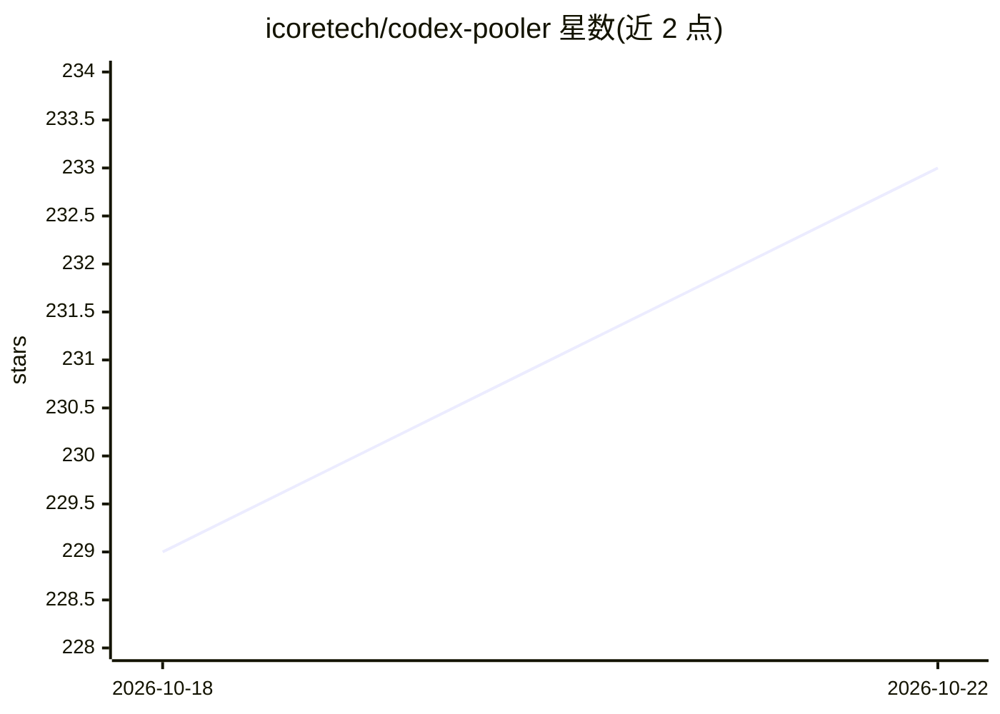

# icoretech/codex-pooler

⭐ 233 · Elixir · NOASSERTION · 推送 2026-10-22 · [GitHub](https://github.com/icoretech/codex-pooler) · [官网](https://codex-pooler.com) · 组织维护 · 中文 README

**自托管的 Codex 网关：用稳定的 Pool API key 管理多 Codex 账号**

面向团队与 agent 使用者的自托管网关：客户端发送 Codex 后端或 OpenAI 兼容请求，网关基于模型支持、配额、限额、会话连续性、路由策略与健康状况选择上游账号。Pool key 在账号增删、生命周期与容量变化时保持不变。管理面覆盖 Pool、账号、API key、路由、用量与审计日志，不存储提示词、文件、音视频或 Codex 密钥；支持按 key 设置请求限额与用量配额、个人用量面板、账号邀请接入、告警与模型降级检测，可通过 Docker Compose、Railway 或 Kubernetes 部署，并给出 20 余种客户端（Codex CLI、OpenCode、Cursor、Cline 等）的配置示例。

## 筛选速览

| 维度 | 判定 | 备注 |
|---|---|---|
| AI 角色 | `ai-ecosystem` | LLM/agent 周边工具 |
| 许可风险 | `none` | NOASSERTION |
| 部署形态 | `self-host` | docker 或自建部署 |
| 模型依赖 | — | README 未给出锁定关系 |
| 硬件要求 | — | 无带数字的原话,不猜 |
| 安装摩擦 | `low` | 无编译、无系统依赖或容器化 |
| 成熟度 | — | 结构信号不足 |

## 能力要点

- 按模型支持/配额/健康/会话连续性自动选择上游账号
- Pool API key 在账号变更时保持稳定，避免共享账号凭证
- 不存储提示词、回复、文件、音视频与原始 Codex 密钥
- 支持图像生成编辑、语音转录与按 key 的用量限额

## 适用场景

- 团队共享多个 Codex 账号容量并统一发 API key
- 让 Codex CLI、OpenCode、Cursor 等客户端经由一个自托管入口工作
- 追踪各 key 的用量、成本与账号健康状况

## 场景标签

`模型网关` · 领域:Agent 开发

## 证据(README 行号)

> L70: Codex Pooler is a self-hosted gateway for running Codex-compatible agents,
> L76: Clients send familiar Codex backend or OpenAI-compatible requests; Codex Pooler
> L82: Operators get one place to manage Pools, accounts, API keys, saved resets,

## 星数曲线

2026-10-18 229 → 2026-10-22 233（+4）

---
*卡片 v1 · prompt 1.4 · 生成 2026-10-22 · 置信度 high · 依据 README sha `fb3af3c071e3` · [字段定义](../../DATASET.md)*
