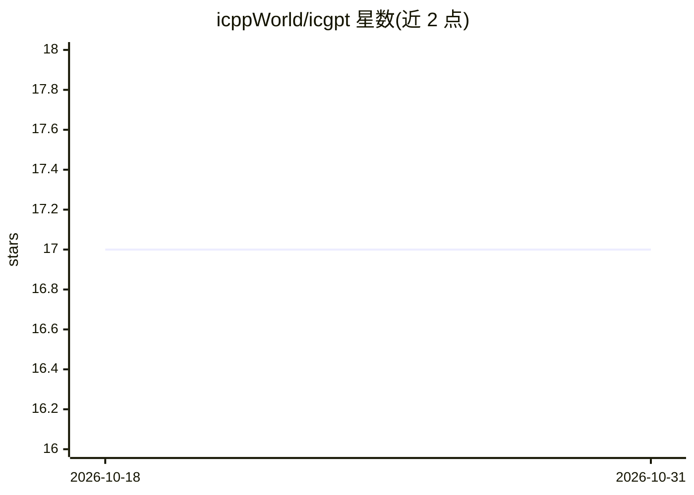

# icppWorld/icgpt

⭐ 17 · JavaScript · MIT · 推送 2026-10-29 · [GitHub](https://github.com/icppWorld/icgpt) · [官网](https://icgpt.icpp.world) · 组织维护

**链上 LLM 提示词工作室：在 IC 容器内运行推理**

运行于 Internet Computer 区块链上的 Prompt Studio 前端应用：LLM（llama_cpp_canister，基于 llama.cpp 编译为 wasm）完全在 canister 内执行推理，权重存于 stable memory，无任何链下 API 调用，提示缓存也按用户隔离存于容器内。当前部署 5 个 GGUF 模型（Qwen2.5/3、Gemma-3-270M、LFM2.5 等），通过 icp-cli 工具链部署，含管理端 canister 实现早鸟门禁与白名单。面向在链上设计、测试提示词的用户；自 2023 年起运行。

## 筛选速览

| 维度 | 判定 | 备注 |
|---|---|---|
| AI 角色 | `ai-native` | 本体是模型或模型工具 |
| 许可风险 | `permissive` | MIT |
| 部署形态 | `library` | 以包/库形式分发 |
| 模型依赖 | local-ok | 支持本地模型 |
| 硬件要求 | — | 无带数字的原话,不猜 |
| 安装摩擦 | `low` | 无编译、无系统依赖或容器化 |
| 成熟度 | `idea` | |

## 能力要点

- LLM 推理完全在 IC canister 内完成，权重存 stable memory，无链下 API 调用
- 部署 5 个 GGUF 模型（Qwen2.5/Qwen3/Gemma-3-270M/LFM2.5），单模型单容器
- icp-cli 部署体系（dfx 已退役），声明式 icp.yaml 描述容器与环境
- icgpt_admin 管理容器提供早鸟白名单硬门禁

## 适用场景

- 在真实链上环境中设计、测试与迭代提示词
- 验证 canister 内 LLM 推理的行为与输出
- 为 funnAI 任务板准备提示词（官方预告）

## 场景标签

`提示工程` · 领域:Agent 开发

## 证据(README 行号)

> L3: **Design, test & refine your prompts against a real LLM — running verifiably
> L13: The LLM runs entirely inside Internet Computer canisters — on-chain in the most
> L15: anywhere: the weights live in the canister's stable memory, and every token is

## 星数曲线

2026-10-18 17 → 2026-10-31 17（+0）

---
*卡片 v1 · prompt 1.4 · 生成 2026-10-29 · 置信度 mid · 依据 README sha `b66314f832dc` · [字段定义](../../DATASET.md)*
