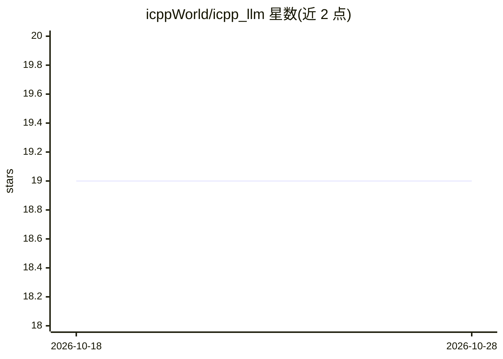

# icppWorld/icpp_llm

⭐ 19 · C++ · MIT · 推送 2026-01-09 · [GitHub](https://github.com/icppWorld/icpp_llm) · [官网](https://icgpt.onicai.com) · 组织维护

**在 Internet Computer 区块链容器中运行 LLM 的项目（llama2）**

将 LLM（如 llama2_c）移植到 Internet Computer（ICP）区块链的 Wasm 容器中运行，通过 icpp-pro 构建，配套 ICGPT 应用可在其后端容器中调用这些模型。README 说明链上运行 LLM 的动机：IC 容器有一致性与指令数限制，但开发部署流程简单、基于区块链密码学的安全机制、并便于与 tokenomics 集成。提供分步部署指南，QA 通过 conda 环境与 Makefile 本地运行。

## 筛选速览

| 维度 | 判定 | 备注 |
|---|---|---|
| AI 角色 | `ai-native` | 本体是模型或模型工具 |
| 许可风险 | `permissive` | MIT |
| 部署形态 | `library` | 以包/库形式分发 |
| 模型依赖 | — | README 未给出锁定关系 |
| 硬件要求 | — | 无带数字的原话,不猜 |
| 安装摩擦 | `low` | 无编译、无系统依赖或容器化 |
| 成熟度 | — | 结构信号不足 |

## 能力要点

- LLM 在 ICP 后端容器（canister）中运行，配套 ICGPT 应用
- 提供部署首个 LLM 到 Internet Computer 的分步指南（llama2_c）
- 基于 icpp-pro 构建，QA 可通过 make all-tests 本地运行并接入 GitHub Actions CI

## 适用场景

- 把 LLM 部署为 Internet Computer 链上容器服务
- 研究生成式 AI dApp 与 tokenomics 的链上集成
- 在受控访问的端点上小范围内试用链上模型

## 场景标签

`推理引擎` · 领域:训练与推理

## 证据(README 行号)

> L3: # LLMs for the Internet Computer
> L9: _The LLMs of this repo run in it's back-end canisters._
> L13: A step-by-step guide to deploy your first LLM to the internet computer is provided in llama2_c/README.md.

## 星数曲线

2026-10-18 19 → 2026-10-28 19（+0）

---
*卡片 v1 · prompt 1.4 · 生成 2026-10-28 · 置信度 low · 依据 README sha `94bd16c4cadf` · [字段定义](../../DATASET.md)*
