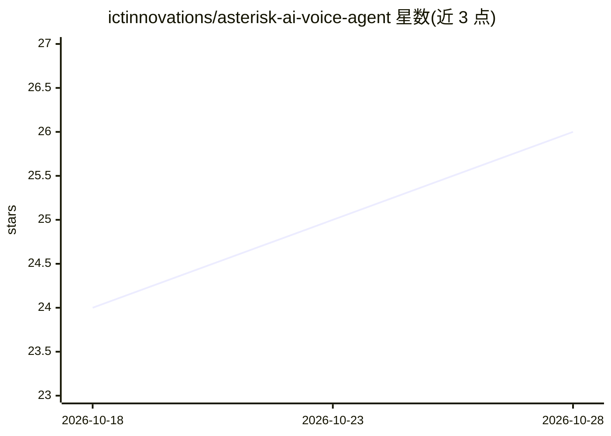

# ictinnovations/asterisk-ai-voice-agent

⭐ 26 · Python · MIT · 推送 2026-10-17 · [GitHub](https://github.com/ictinnovations/asterisk-ai-voice-agent) · [官网](https://ictinnovations.com/asterisk-ai-voice-agent-audiosocket-open-source/) · 组织维护

**自托管的 Asterisk AI 电话语音代理边车**

与 Asterisk PBX 通过 AudioSocket 桥接通话的侧车服务：运行流式 STT→LLM→TTS 循环，让来电者与 AI 进行可打断的往返对话。语音输入支持 OpenAI Whisper、ElevenLabs Scribe 或 60db；LLM 默认为 Anthropic Claude（流式逐 token，可按 PORTING.md 接口替换）；语音输出用本地 Piper 或 ElevenLabs。支持 barge-in 打断、工具调用（webhook 回调）、YAML 人设配置，并提供 Docker 与 pip 两种安装方式，需 Asterisk 18+ 与 Python 3.10+。

## 筛选速览

| 维度 | 判定 | 备注 |
|---|---|---|
| AI 角色 | `ai-native` | 本体是模型或模型工具 |
| 许可风险 | `permissive` | MIT |
| 部署形态 | `self-host` | docker 或自建部署 |
| 模型依赖 | locked-api |  |
| 硬件要求 | — | 无带数字的原话,不猜 |
| 安装摩擦 | `low` | 无编译、无系统依赖或容器化 |
| 成熟度 | — | 结构信号不足 |

## 能力要点

- 流式 STT→LLM→TTS 循环，支持 barge-in 打断
- LLM 默认 Anthropic Claude，流式 token 输出，可按模块接口替换
- 工具调用经用户控制的 webhook（转接/回呼/CRM 查询）
- Piper TTS 完全本地运行，无需 API key

## 适用场景

- 给现有 Asterisk 电话系统接入 AI 语音应答
- 自托管呼叫中心/客服电话代理，不经按分钟计费的 SaaS
- 通过工具 webhook 让电话代理转接、查 CRM、安排回呼

## 场景标签

`语音 Agent` · 领域:对话与助手

## 证据(README 行号)

> L7: Put an AI agent on the phone. Asterisk bridges a live call to this sidecar over AudioSocket, and the sidecar runs a 
> L21: - **The brain** is Anthropic Claude, streamed token-by-token so the agent starts replying before the whole answer i

## 星数曲线

2026-10-18 24 → 2026-10-28 26（+2）

---
*卡片 v1 · prompt 1.4 · 生成 2026-10-27 · 置信度 high · 依据 README sha `90f0b28557e8` · [字段定义](../../DATASET.md)*
