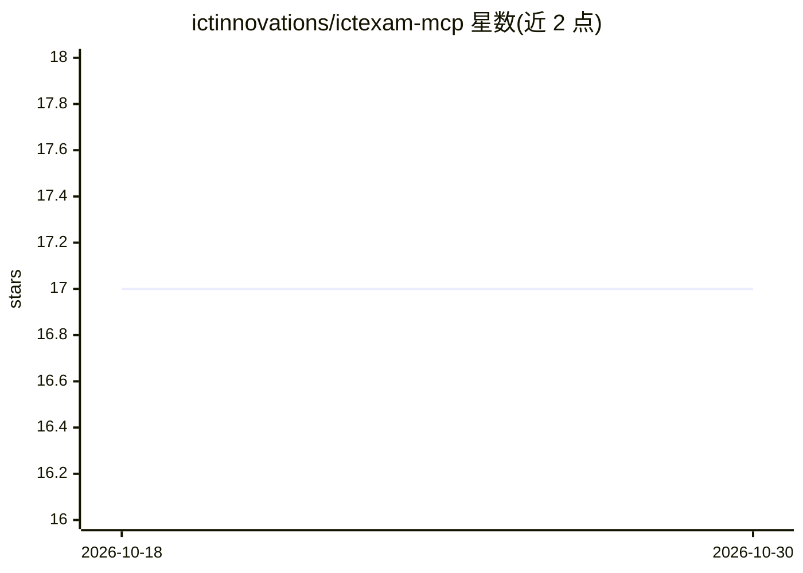

# ictinnovations/ictexam-mcp

⭐ 17 · TypeScript · MIT · 推送 2026-10-26 · [GitHub](https://github.com/ictinnovations/ictexam-mcp) · [官网](https://www.ictlms.net) · 组织维护

**让 AI 助手读写 ICTExam 考试平台数据的 MCP 服务器**

面向 ICTExam 考试编写与自动评分平台的 Model Context Protocol 服务器：为 MCP 客户端（如 Claude Desktop）提供 6 个只读工具（列出/查看试卷、班级、科目、成绩册、逐题分析）与 3 个写工具（AI 解析 PDF/DOCX 试卷为结构化题目、发布/撤回试卷）。默认只读，写工具需设置 ICTEXAM_MCP_ALLOW_WRITE=true 才注册。通过账号密码登录获取会话 Cookie 访问 REST API，无需单独 API key；AI 解析会消耗服务器端 AI 额度。

## 筛选速览

| 维度 | 判定 | 备注 |
|---|---|---|
| AI 角色 | `ai-ecosystem` | LLM/agent 周边工具 |
| 许可风险 | `permissive` | MIT |
| 部署形态 | `library` | 以包/库形式分发 |
| 模型依赖 | — | README 未给出锁定关系 |
| 硬件要求 | — | 无带数字的原话,不猜 |
| 安装摩擦 | `low` | 无编译、无系统依赖或容器化 |
| 成熟度 | — | 结构信号不足 |

## 能力要点

- 6 个只读工具读取试卷、成绩册与逐题难度分析
- AI 解析 PDF/DOCX 试卷为结构化题目（消耗平台 AI 额度）
- 默认只读，写工具需显式开关开启才注册
- 会话 Cookie + CSRF 认证，无需 API key

## 适用场景

- 让 Claude 等 AI 助手查看我的考试与成绩数据
- 用 AI 把本地 Word/PDF 试卷解析成平台上的结构化考试
- 让助手代为发布或撤回面向学生的试卷

## 场景标签

`文档解析` · 领域:知识与检索

## 证据(README 行号)

> L3: A Model Context Protocol server for
> L7: It lets an AI assistant read your exams, gradebooks and per-question item

## 星数曲线

2026-10-18 17 → 2026-10-30 17（+0）

---
*卡片 v1 · prompt 1.4 · 生成 2026-10-30 · 置信度 high · 依据 README sha `62116c33a56e` · [字段定义](../../DATASET.md)*
