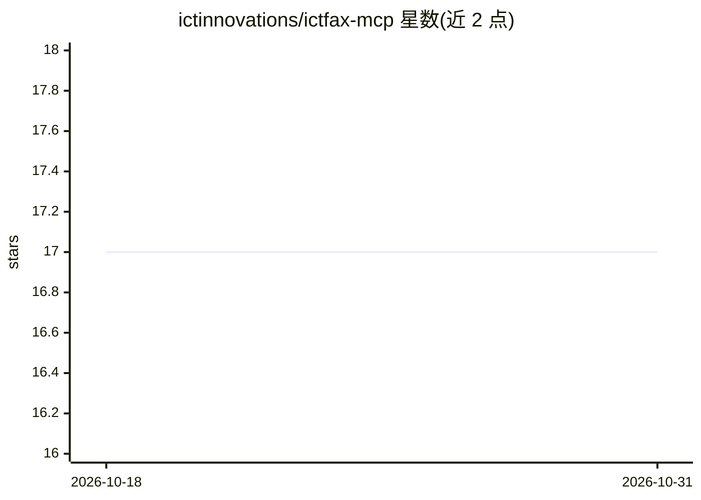

# ictinnovations/ictfax-mcp

⭐ 17 · TypeScript · MIT · 推送 2026-10-26 · [GitHub](https://github.com/ictinnovations/ictfax-mcp) · [官网](https://www.ictfax.org) · 组织维护

**让 AI 助手通过 ICTCore REST 收发与追踪传真的 MCP 服务器**

ICTFax 的 Model Context Protocol 服务器，基于 ICTCore REST API，使 AI 助手可列出传真发送记录、按 id 查询传输状态；默认只读，设置 ICTFAX_MCP_ALLOW_WRITE=true 后才注册上传文档与发送传真两个写工具。通过环境变量配置 ICTCore 的地址、账号与超时等参数，认证走 JWT Bearer。面向已部署 ICTFax/ICTCore 的用户，需 Node.js 18+，MIT 许可，由 ICT Innovations 团队维护。

## 筛选速览

| 维度 | 判定 | 备注 |
|---|---|---|
| AI 角色 | `ai-ecosystem` | LLM/agent 周边工具 |
| 许可风险 | `permissive` | MIT |
| 部署形态 | `library` | 以包/库形式分发 |
| 模型依赖 | — | README 未给出锁定关系 |
| 硬件要求 | — | 无带数字的原话,不猜 |
| 安装摩擦 | `low` | 无编译、无系统依赖或容器化 |
| 成熟度 | — | 结构信号不足 |

## 能力要点

- 提供 ictfax_list_faxes / ictfax_get_fax_status 只读工具
- 写操作（上传 PDF、拨打真实号码发送传真）默认不注册，需显式开启
- 经 JWT Bearer 认证对接 ICTCore REST，附 Claude Desktop 配置示例
- 支持 npx 免安装运行或全局 npm 安装

## 适用场景

- 在 Claude 等 MCP 客户端中查询 ICTFax 服务器上的传真发送状态
- 经 AI 助手上传 PDF 并向真实号码发送传真（需手动开启写权限）
- 运维人员让 AI 助手列举传真传输记录与方向

## 场景标签

 · 领域:通信/传真服务接入

## 证据(README 行号)

> L3: A Model Context Protocol server for
> L7: It lets an AI assistant list fax transmissions and check their status, and — only

## 星数曲线

2026-10-18 17 → 2026-10-31 17（+0）

---
*卡片 v1 · prompt 1.4 · 生成 2026-10-29 · 置信度 high · 依据 README sha `694188c45c78` · [字段定义](../../DATASET.md)*
