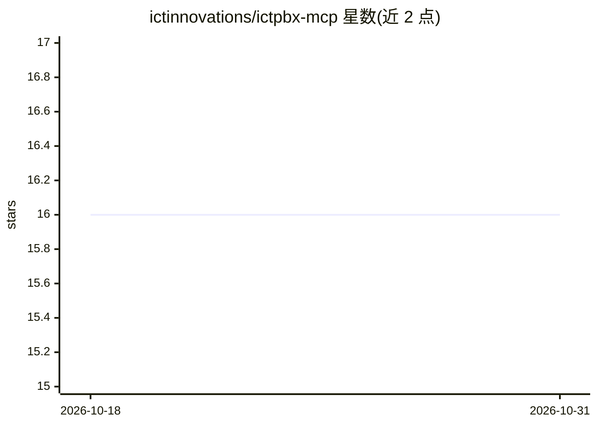

# ictinnovations/ictpbx-mcp

⭐ 16 · TypeScript · MIT · 推送 2026-10-26 · [GitHub](https://github.com/ictinnovations/ictpbx-mcp) · [官网](https://ictpbx.com) · 组织维护

**只读 MCP 服务器：让 AI 助手查询 ICTPBX 话务状态**

面向 ICTPBX（基于 ICTCore 的多租户 IP-PBX）的 Model Context Protocol 服务器，通过 ICTCore REST API 让 AI 助手读取分机、DID 号码、SIP 中继供应商、租户与 PBX 统计数据。定位为只读：不发起呼叫、不修改配置。提供 5 个查询工具，JWT 认证令牌首次使用时获取并自动刷新。以 npm 包形式分发，需 Node.js 18+，通过环境变量配置连接。

## 筛选速览

| 维度 | 判定 | 备注 |
|---|---|---|
| AI 角色 | `ai-ecosystem` | LLM/agent 周边工具 |
| 许可风险 | `permissive` | MIT |
| 部署形态 | `library` | 以包/库形式分发 |
| 模型依赖 | — | README 未给出锁定关系 |
| 硬件要求 | — | 无带数字的原话,不猜 |
| 安装摩擦 | `low` | 无编译、无系统依赖或容器化 |
| 成熟度 | — | 结构信号不足 |

## 能力要点

- 只读访问：不发起呼叫、不更改 PBX 配置
- 5 个工具：PBX 统计、分机、DID、SIP 中继、租户列表
- JWT 自动获取与刷新（ICTCore /authenticate）
- 支持 npx 免安装运行

## 适用场景

- 用 Claude Desktop 等 MCP 客户端查询 PBX 分机与租户状态
- 通过对话获取 ICTPBX 的实时统计数据
- 运维人员让 AI 助手只读巡检 SIP 中继与 DID 配置

## 场景标签

 · 领域:通信/企业电话系统

## 证据(README 行号)

> L3: A Model Context Protocol server for
> L7: It lets an AI assistant read your PBX state — extensions, DID numbers, SIP trunk

## 星数曲线

2026-10-18 16 → 2026-10-31 16（+0）

---
*卡片 v1 · prompt 1.4 · 生成 2026-10-30 · 置信度 high · 依据 README sha `659fb9e11239` · [字段定义](../../DATASET.md)*
