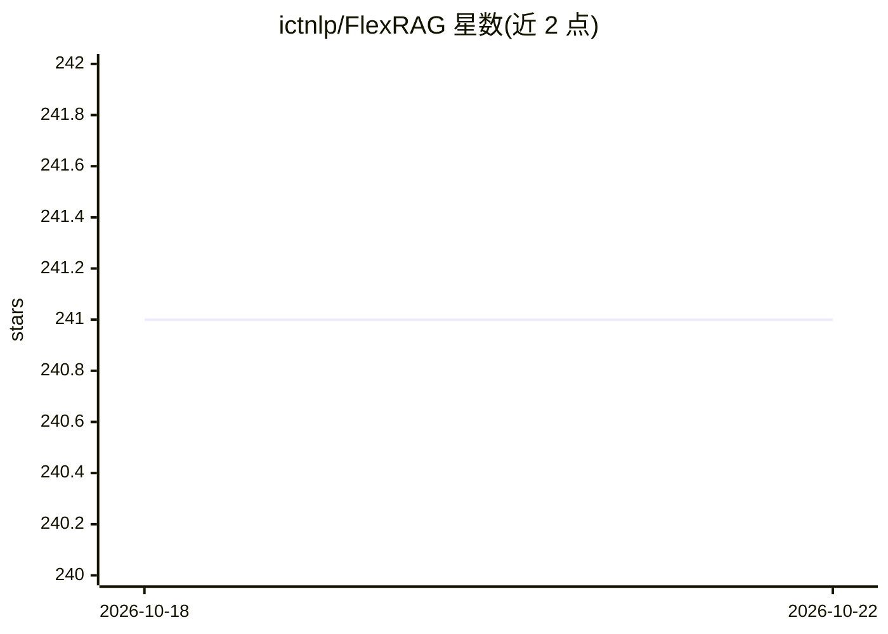

# ictnlp/FlexRAG

⭐ 241 · Python · MIT · 推送 2026-08-31 · [GitHub](https://github.com/ictnlp/FlexRAG) · [官网](https://flexrag.readthedocs.io/en/latest) · 组织维护 · 中文 README

**面向研究与原型的 RAG 框架：从数据准备到评测的端到端流水线**

开源的检索增强生成（RAG）框架，覆盖从数据准备到系统评测的端到端流程，支持文本、多模态与可访问网页的 RAG 场景，采用模块化架构便于定制扩展。面向研究人员与开发者，用于快速复现、开发与评测 RAG 系统、分享研究成果并构建算法原型。提供检索器（LocalRetriever 可从 HuggingFace Hub 加载）、检索评测指标（如 RetrievalMAP）与 run_retriever 入口，附基准测试与论文（arXiv），以 pip 安装，MIT 许可。

## 筛选速览

| 维度 | 判定 | 备注 |
|---|---|---|
| AI 角色 | `ai-ecosystem` | LLM/agent 周边工具 |
| 许可风险 | `permissive` | MIT |
| 部署形态 | `library` | 以包/库形式分发 |
| 模型依赖 | — | README 未给出锁定关系 |
| 硬件要求 | — | 无带数字的原话,不猜 |
| 安装摩擦 | `low` | 无编译、无系统依赖或容器化 |
| 成熟度 | — | 结构信号不足 |

## 能力要点

- 端到端 RAG 流水线：数据准备到系统评测
- 支持文本、多模态、可访问网页三类 RAG 场景
- 模块化架构，支持检索指标评测（如 RetrievalMAP）
- 提供 Windows wheel 与中文文档、arXiv 论文

## 适用场景

- 研究人员快速复现与评测 RAG 算法
- 开发者搭建文本或多模态 RAG 原型系统
- 基于框架进行检索组件定制与扩展

## 场景标签

 · 领域:NLP/RAG 框架

## 证据(README 行号)

> L19: FlexRAG is an innovative open-source framework designed to streamline the rapid reproduction, development, and eval
> L27: - **2025-06-17**: Our publication FlexRAG: A Flexible and Comprehensive Framework for Retrieval-Augmented Generatio
> L47: FlexRAG is designed with a **modular** architecture, allowing you to easily customize and extend the framework to m

## 星数曲线

2026-10-18 241 → 2026-10-22 241（+0）

---
*卡片 v1 · prompt 1.4 · 生成 2026-10-22 · 置信度 high · 依据 README sha `7682f2e7013c` · [字段定义](../../DATASET.md)*
