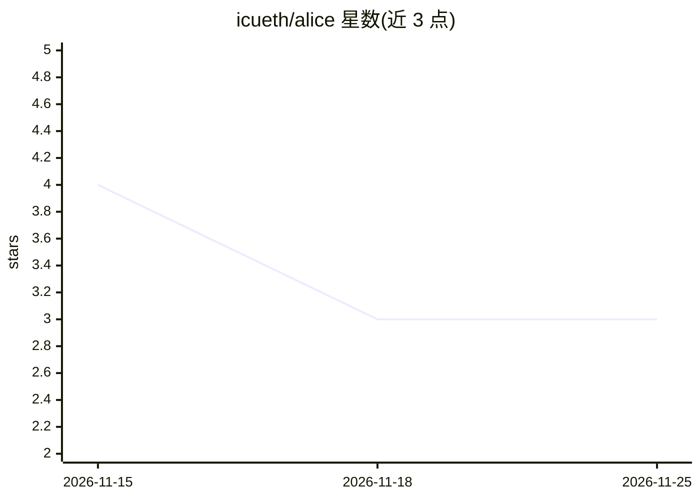

# icueth/alice

⭐ 3 · Rust · MIT · 推送 2026-10-18 · [GitHub](https://github.com/icueth/alice) · 个人维护

**AI 编码 agent 的本地长期记忆，多工具共享**

用 Rust 编写的单二进制记忆引擎：daemon 独占 SQLite 存储，写入 50ms 内确认，嵌入与索引后台运行；记忆分提炼层与原始转录层，检索组合多语言向量、BM25、trigram 与标识符匹配。提供 7 个 MCP 工具、CLI 与 HTTP API，支持 Claude Code/Codex 会话自动捕获、审查收件箱、历史撤销、备份、密钥脱敏。含可选 judge（TypeSafe Jev）做去重与分级。目前 alpha，无打包发行版，仅源码安装。

## 筛选速览

| 维度 | 判定 | 备注 |
|---|---|---|
| AI 角色 | `ai-ecosystem` | LLM/agent 周边工具 |
| 许可风险 | `permissive` | MIT |
| 部署形态 | `library` | 以包/库形式分发 |
| 模型依赖 | local-ok | 支持本地模型 |
| 硬件要求 | — | 无带数字的原话,不猜 |
| 安装摩擦 | `medium` | 含编译或系统依赖之一 |
| 成熟度 | `idea` | |

## 能力要点

- 单 Rust 二进制内置 daemon、CLI、MCP server 与嵌入运行时
- 混合检索：多语言向量、BM25、Thai/CJK trigram、代码标识符匹配
- 带有效期的知识图谱与 as_of 时间线查询
- 写入不阻塞：daemon 不可用时写入落盘队列

## 适用场景

- 多个 AI 编码 agent 跨会话共享一份本地记忆
- 自动捕获并提炼 Claude Code / Codex 会话为知识条目
- 小团队共享服务器上的记忆租户

## 场景标签

`Agent 记忆` `知识图谱` · 领域:Agent 开发

## 证据(README 行号)

> L3:  Long-term memory for AI coding agents.
> L33: - **One binary.** Daemon, CLI, MCP server and agent hooks in a single Rust binary with the embedding runtime built 
> L117: Register `alice mcp` as a stdio MCP server (docs/setup-local.md lets an agent do this for you). The shim starts th

## 星数曲线

2026-11-15 4 → 2026-11-25 3（-1）

---
*卡片 v1 · prompt 1.4 · 生成 2026-11-21 · 置信度 high · 依据 README sha `6efe6e74416d` · [字段定义](../../DATASET.md)*
