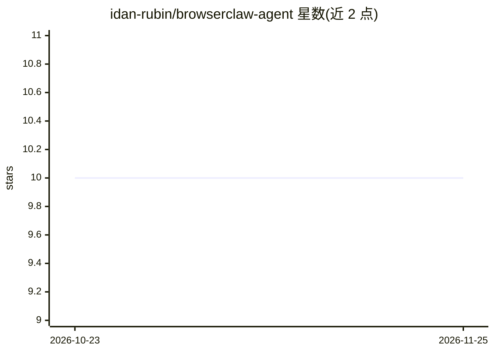

# idan-rubin/browserclaw-agent

⭐ 10 · TypeScript · MIT · 推送 2026-11-21 · [GitHub](https://github.com/idan-rubin/browserclaw-agent) · 个人维护

**面向开发者的 AI 浏览器自动化 Agent，提示词驱动并生成可复用技能**

运行于 BrowserClaw 浏览器库之上的 LLM Agent：读取页面无障碍快照，经 LLM 决策并执行操作，每次运行最多 100 步，带记忆草稿与动作成败评估。内置反机器人验证、Turnstile、弹窗关闭、循环检测、标签页管理等技能，成功的运行会按域名生成技能文件存入 MinIO，下次复用为行动手册。LLM 提供方可配置为 Claude/GPT/Gemini/Groq/本地模型。需要 Node.js 22+ 与 Chrome，支持本地开发模式与 Docker 全栈部署。

## 筛选速览

| 维度 | 判定 | 备注 |
|---|---|---|
| AI 角色 | `ai-native` | 本体是模型或模型工具 |
| 许可风险 | `permissive` | MIT |
| 部署形态 | `library` | 以包/库形式分发 |
| 模型依赖 | — | README 未给出锁定关系 |
| 硬件要求 | — | 无带数字的原话,不猜 |
| 安装摩擦 | `low` | 无编译、无系统依赖或容器化 |
| 成熟度 | — | 结构信号不足 |

## 能力要点

- 快照→LLM→动作循环，每次运行最多 100 步并自我评估动作成败
- 按域名自动生成与更新技能文件（存于 MinIO），下次运行复用为行动手册
- 内置 CDP 级反机器人/Cloudflare Turnstile 处理与弹窗、标签页管理
- LLM 无锁定：Claude、GPT、Gemini、Groq、本地模型均可配置，另附 BYOK 多租户

## 适用场景

- 用一句自然语言提示词自动完成网页信息收集任务
- 对同一网站反复执行自动化操作时复用已学习的技能手册
- 在 TypeScript/Node 项目中直接使用 browserclaw 库构建自己的浏览器 Agent

## 场景标签

`浏览器自动化` `网页抓取` · 领域:效率与自动化

## 证据(README 行号)

> L16: - 😎 **The agent** — the driver. Reasoning, obstacle recovery, learned skills. _That's this project._
> L37: The agent reads an accessibility snapshot of the page, decides what to do next, and executes the action. Up to 100 

## 星数曲线

2026-10-23 10 → 2026-11-25 10（+0）

---
*卡片 v1 · prompt 1.4 · 生成 2026-11-19 · 置信度 high · 依据 README sha `ad86176955c6` · [字段定义](../../DATASET.md)*
