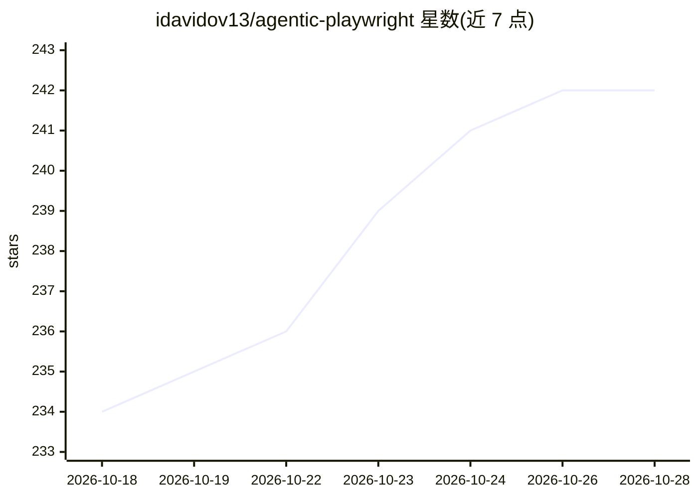

# idavidov13/agentic-playwright

⭐ 245 · Python · MIT · 推送 2026-10-22 · [GitHub](https://github.com/idavidov13/agentic-playwright) · 个人维护

**供 AI 编程助手使用的 Playwright+TypeScript 测试脚手架**

面向测试开发者的生产级 Playwright + TypeScript 项目脚手架：通过 npm create 一键生成含页面对象、API 契约测试（Zod 校验）、数据工厂、CI 与报告的完整测试框架，并内置 Claude Code、Cursor、GitHub Copilot 三套自动加载的规则树与 17 个技能。关键机制包括 Constitution 执行钩子（写文件前机械拦截禁止模式）与置信度门控工作流（低于 5 分须停止询问）。示例文件为演示模式，需替换为真实应用页面；需 Node.js v22+。提供 Dev Container 与本地脚本两种附加安装路径。

## 筛选速览

| 维度 | 判定 | 备注 |
|---|---|---|
| AI 角色 | `ai-ecosystem` | LLM/agent 周边工具 |
| 许可风险 | `permissive` | MIT |
| 部署形态 | `self-host` | docker 或自建部署 |
| 模型依赖 | locked-api |  |
| 硬件要求 | — | 无带数字的原话,不猜 |
| 安装摩擦 | `low` | 无编译、无系统依赖或容器化 |
| 成熟度 | — | 结构信号不足 |

## 能力要点

- 一键脚手架并运行冒烟测试，5 分钟内看到绿色结果
- 三套 AI 工具（Claude Code/Cursor/Copilot）规则树自动加载，17 个技能
- Constitution 钩子在写入前拦截 waitForTimeout、XPath 等禁止模式
- 置信度门控：计划需含 Confidence 1-10，低于 5 必须向用户询问

## 适用场景

- 让 AI 编程助手按既定规范生成 Playwright 测试
- 快速搭建类型安全、页面对象模式的 E2E/API 测试工程
- 在 CI 中统一团队测试风格并机械拦截违规写法

## 场景标签

`代码生成` · 领域:编码与开发

## 证据(README 行号)

> L14:  Production-grade Playwright + TypeScript Scaffold for Agentic Testing.
> L79: - **AI-Assisted Development** -- Modular orchestrator rules for Claude Code, Cursor, and GitHub Copilot with glob-s

## 星数曲线

2026-10-18 234 → 2026-10-28 242（+8）

---
*卡片 v1 · prompt 1.4 · 生成 2026-10-22 · 置信度 high · 依据 README sha `6fd932451545` · [字段定义](../../DATASET.md)*
