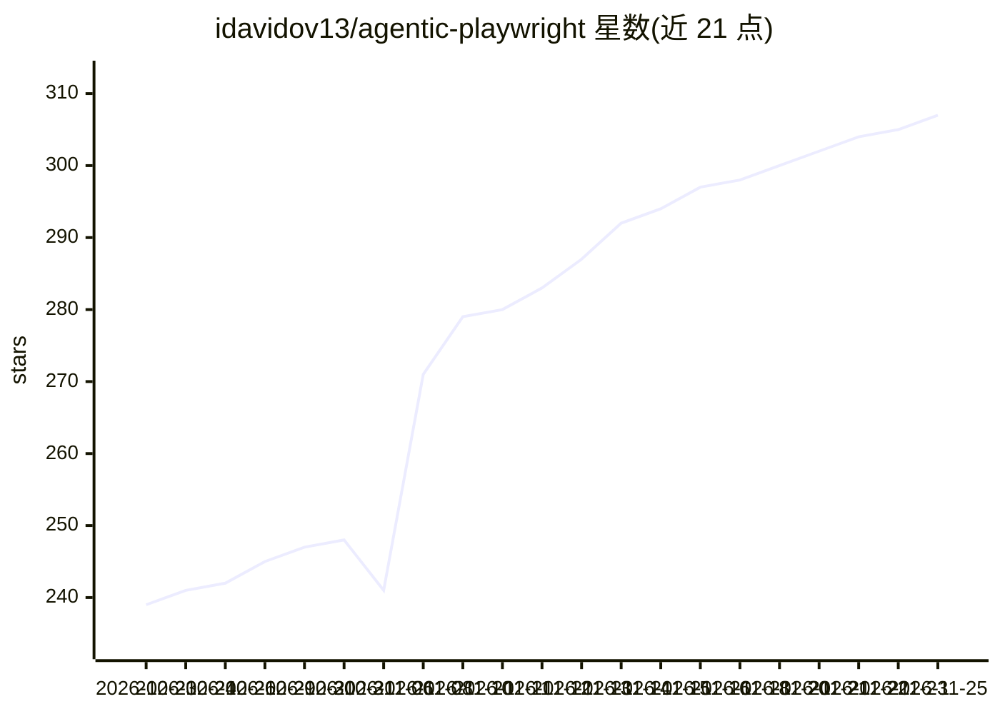

# idavidov13/agentic-playwright

⭐ 307 · Python · MIT · 推送 2026-11-18 · [GitHub](https://github.com/idavidov13/agentic-playwright) · 个人维护

**内置 AI 编码代理规则与钩子的 Playwright+TypeScript 测试脚手架**

一个可直接运行的 Playwright + TypeScript 测试脚手架模板，包含页面对象、API 契约测试、数据工厂、CI 配置与 Zod schema 校验。核心机制是通过 AGENTS.md 宪法文件与 17 个 skills 让 AI 编码代理（Claude Code、Codex、Cursor、Copilot）自动加载测试规范，并用 PreToolUse 钩子与 pre-commit 扫描阻止 XPath、硬等待等 18 类违规模式写入。通过 npm create 一条命令生成项目并运行冒烟测试。作者声明规则只保证测试的形式，测试价值仍需人工评审。

## 筛选速览

| 维度 | 判定 | 备注 |
|---|---|---|
| AI 角色 | `ai-enhanced` | 去掉 AI 部分产品仍成立 |
| 许可风险 | `permissive` | MIT |
| 部署形态 | `self-host` | docker 或自建部署 |
| 模型依赖 | — | README 未给出锁定关系 |
| 硬件要求 | — | 无带数字的原话,不猜 |
| 安装摩擦 | `low` | 无编译、无系统依赖或容器化 |
| 成熟度 | — | 结构信号不足 |

## 能力要点

- AGENTS.md 宪法 + 17 skills 自动加载，Codex/Cursor/Copilot 原生读取，Claude Code 经 CLAUDE.md 导入
- Claude Code PreToolUse 钩子与 pre-commit/CI 扫描阻止 18 类宪法违规（XPath、waitForTimeout 等）
- 置信度门控工作流：计划需含 Confidence/Rationale/Unknowns，低于 5 须停下来向用户询问
- npm create 一条命令脚手架化并跑通冒烟测试，提供 Dev Container（预装 Node/浏览器/Python3/Claude Code CLI）

## 适用场景

- 为 Web 项目快速搭建带 AI 代理规范的 Playwright E2E 与 API 测试框架
- 让多个 AI 编码代理在统一的测试宪法约束下生成一致的测试代码
- 通过钩子与 CI 门禁防止 AI 生成的测试引入硬等待、XPath 等反模式

## 场景标签

`代码生成` · 领域:编码与开发

## 证据(README 行号)

> L14:  Production-grade Playwright + TypeScript Scaffold for Agentic Testing.
> L60: waits, no `any`, one tag per test — enforced by one `AGENTS.md` Constitution and 17 skills the
> L82: - **AI-Assisted Development** -- One orchestrator, `AGENTS.md`, holds the Constitution, the workflow and the Skills

## 星数曲线

2026-10-23 239 → 2026-11-25 307（+68）

---
*卡片 v1 · prompt 1.4 · 生成 2026-11-25 · 置信度 high · 依据 README sha `56f4f0bb823f` · [字段定义](../../DATASET.md)*
