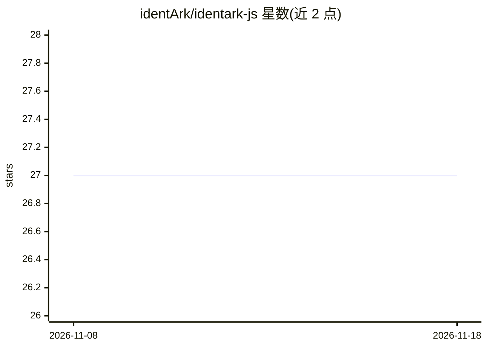

# identArk/identark-js

⭐ 27 · TypeScript · MIT · 推送 2026-11-17 · [GitHub](https://github.com/identArk/identark-js) · [官网](https://identark.io) · 组织维护

**面向 AI agent 的 TypeScript SDK：零密钥执行与治理路由**

IdentArk AgentGateway 的 TypeScript SDK，供构建不持有密钥、不维护状态的 agent 使用。提供三种网关：DirectGateway 直连 OpenAI/Anthropic/Mistral 及 OpenAI 兼容端点（Ollama、vLLM）；ControlPlaneGateway 经 IdentArk 控制平面生产路由，按环境变量自动检测；MockGateway 用于单元测试。机制覆盖流式输出、OpenAI 风格工具调用、预签名 URL 文件 I/O、内置价格表的成本追踪，以及支付/退款等受治理动作（授权、预算、人工批准、幂等键）。零运行时依赖，类型严格模式。生产路径依赖 IdentArk 控制平面服务。

## 筛选速览

| 维度 | 判定 | 备注 |
|---|---|---|
| AI 角色 | `ai-ecosystem` | LLM/agent 周边工具 |
| 许可风险 | `permissive` | MIT |
| 部署形态 | `library` | 以包/库形式分发 |
| 模型依赖 | local-ok | 支持本地模型 |
| 硬件要求 | — | 无带数字的原话,不猜 |
| 安装摩擦 | `low` | 无编译、无系统依赖或容器化 |
| 成熟度 | — | 结构信号不足 |

## 能力要点

- DirectGateway / ControlPlaneGateway / MockGateway 三种可互换网关
- agent 不持有 API 密钥，密钥留存于控制平面
- 内置价格表的会话成本计算（本地 Ollama 计 $0）
- 受治理动作：授权、预算、人工批准与幂等键防重复执行

## 适用场景

- 构建多轮对话、函数调用与文件读写的 agent 应用
- 在支付等敏感动作上套用预算与人工审批
- 通过 MockGateway 对 agent 逻辑做单元测试

## 场景标签

`Agent 框架` `模型网关` · 领域:Agent 开发

## 证据(README 行号)

> L5: The AgentGateway Protocol — secure, scalable agent execution infrastructure.
> L12: - **DirectGateway**: Call OpenAI, Anthropic, Mistral, or any OpenAI-compatible endpoint (Ollama, vLLM) directly
> L182: #### `ControlPlaneGateway`

## 星数曲线

2026-11-08 27 → 2026-11-18 27（+0）

---
*卡片 v1 · prompt 1.4 · 生成 2026-11-18 · 置信度 high · 依据 README sha `ef1d5ed9b0e7` · [字段定义](../../DATASET.md)*
