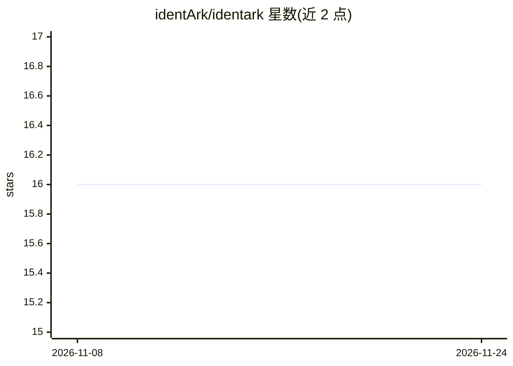

# identArk/identark

⭐ 16 · Python · MIT · 推送 2026-11-23 · [GitHub](https://github.com/identArk/identark) · [官网](https://identark.io) · 组织维护

**给 AI agent 开发者的凭据隔离网关 SDK：代理持密钥、带审批与审计**

identark 是实现 AgentGateway Protocol 的 Python SDK，在 agent 逻辑与外部世界之间提供接口层：agent 进程内不含 LLM API key、数据库凭据或云令牌，密钥由网关持有；提供 DirectGateway（本地开发/CI）与 ControlPlaneGateway（生产）两种实现，代码在两者间切换只需改两行。内置能力申请（request_capability）、预算、人工审批、幂等键防重复执行、会话成本追踪与 MockGateway 测试支持。要求 Python 3.10+，另提供 TypeScript npm 平行 SDK。

## 筛选速览

| 维度 | 判定 | 备注 |
|---|---|---|
| AI 角色 | `ai-ecosystem` | LLM/agent 周边工具 |
| 许可风险 | `permissive` | MIT |
| 部署形态 | `library` | 以包/库形式分发 |
| 模型依赖 | local-ok | 支持本地模型 |
| 硬件要求 | — | 无带数字的原话,不猜 |
| 安装摩擦 | `low` | 无编译、无系统依赖或容器化 |
| 成熟度 | — | 结构信号不足 |

## 能力要点

- agent 运行环境零凭据：密钥由 ControlPlaneGateway 持有
- request_capability 机制：执行前应用授权、预算与人工审批
- 本地 DirectGateway 与生产 ControlPlaneGateway 代码相同，切换仅两行
- 框架无关：支持 LangChain、LlamaIndex 或自定义框架，内置成本追踪与 MockGateway

## 适用场景

- 让 agent 调用支付、退款、GitHub、AWS 等外部动作而不暴露密钥
- 本地开发与生产部署使用同一套 agent 代码
- 满足英国/欧盟数据驻留要求（本地 Ollama 或 Mistral EU）
- 在 CI 中用 MockGateway 无 LLM 调用地测试 agent

## 场景标签

 · 领域:LLM 基础设施/agent 安全与执行

## 证据(README 行号)

> L5: **The AgentGateway Protocol — secure, scalable AI agent execution infrastructure.**
> L25: The SDK implements the **AgentGateway Protocol** — a clean interface between your agent logic and the outside world
> L134: - **Zero-secret agents** — `ControlPlaneGateway` holds no API keys, database credentials, or cloud tokens

## 星数曲线

2026-11-08 16 → 2026-11-24 16（+0）

---
*卡片 v1 · prompt 1.4 · 生成 2026-11-19 · 置信度 high · 依据 README sha `3389664c4b17` · [字段定义](../../DATASET.md)*
