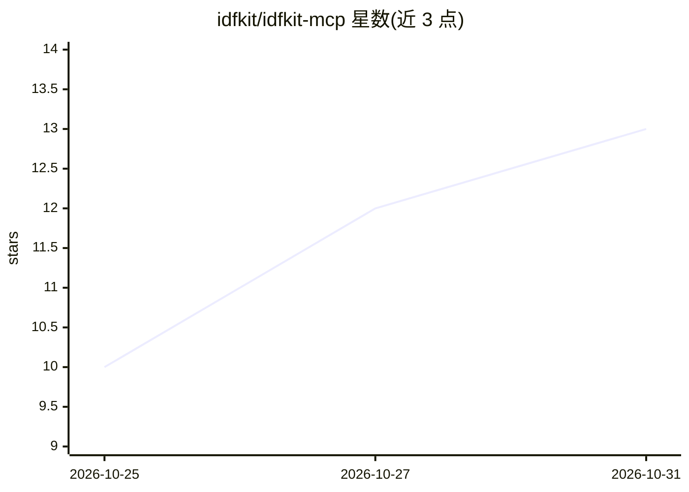

# idfkit/idfkit-mcp

⭐ 13 · Python · MIT · 推送 2026-10-28 · [GitHub](https://github.com/idfkit/idfkit-mcp) · [官网](https://mcp.idfkit.com/) · 组织维护

**让 AI 助手直接操作 EnergyPlus 建筑能耗模型的 MCP 服务器**

基于 idfkit 构建的 Model Context Protocol 服务器，使 Claude、ChatGPT、Cursor 等 MCP 兼容客户端能通过自然语言创建、编辑、校验 EnergyPlus 建筑模型并运行仿真。提供 37 个工具（覆盖 schema 探索、模型读写、仿真运行、气象下载、版本迁移等 10 类）与 13 个只读 MCP 资源；支持 EnergyPlus 8.9–26.2 共 18 个版本，schema 编辑与校验开箱即用，运行仿真需本地安装 EnergyPlus（可通过 PATH 或环境变量自动发现），另提供内置 EnergyPlus 的 Docker 镜像。会话状态持久化到磁盘，便于客户端重启后恢复。

## 筛选速览

| 维度 | 判定 | 备注 |
|---|---|---|
| AI 角色 | `ai-ecosystem` | LLM/agent 周边工具 |
| 许可风险 | `permissive` | MIT |
| 部署形态 | `library` | 以包/库形式分发 |
| 模型依赖 | — | README 未给出锁定关系 |
| 硬件要求 | — | 无带数字的原话,不猜 |
| 安装摩擦 | `medium` | 含编译或系统依赖之一 |
| 成熟度 | — | 结构信号不足 |

## 能力要点

- 37 个工具 + 13 个 MCP 资源，覆盖模型构建/编辑/仿真/迁移全流程
- 支持 EnergyPlus 8.9–26.2 共 18 个版本（内置 schema）
- 交互式 3D 几何查看器与日程热图查看器（MCP Apps）
- 气象站搜索与 EPW/DDY 下载、EnergyPlus 文档全文检索

## 适用场景

- 用自然语言让 AI 助手从零搭建建筑能耗模型
- 加载并修改现有 IDF/epJSON 模型后运行仿真、查询结果
- 查询 EnergyPlus 对象字段约束并链接官方文档

## 场景标签

 · 领域:建筑能耗仿真/LLM 工具生态

## 证据(README 行号)

> L8: An MCP server that lets AI assistants work directly with EnergyPlus building energy models. Connect it to Claude, Ch
> L22: The server exposes **37 tools** across ten categories, plus **13 MCP resources** for read-only data access:
> L16: Built on idfkit, it supports **EnergyPlus 8.9 through 26.2** (18 versions with bundled schemas). Schema exploration

## 星数曲线

2026-10-25 10 → 2026-10-31 13（+3）

---
*卡片 v1 · prompt 1.4 · 生成 2026-10-31 · 置信度 high · 依据 README sha `4b2269da9aa4` · [字段定义](../../DATASET.md)*
