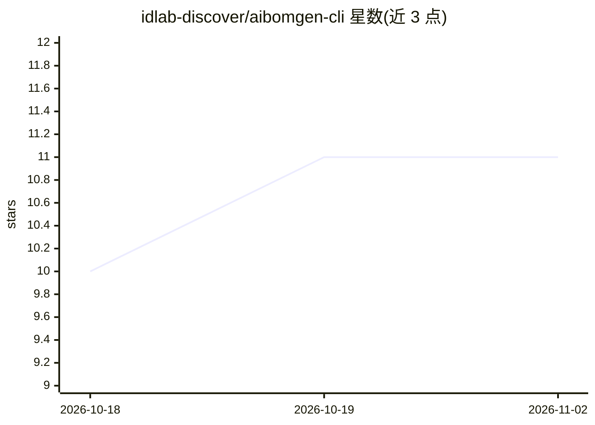

# idlab-discover/aibomgen-cli

⭐ 11 · Go · AGPL-3.0 · 推送 2026-10-22 · [GitHub](https://github.com/idlab-discover/aibomgen-cli) · [官网](https://pkg.go.dev/github.com/idlab-discover/aibomgen-cli) · 组织维护

**扫描仓库中 Hugging Face 模型/数据集使用并生成 CycloneDX AIBoM 的 Go CLI**

面向开发者与供应链合规场景的命令行工具：scan 命令遍历目录中 Python/YAML/JSON/Markdown/shell/Dockerfile/JS-TS 文件检测 AI 相关引用，generate 从 Hugging Face 模型 ID 直接生成 CycloneDX AI/ML 物料清单；另有 validate（含 schema/完整性/漏洞校验）、completeness 评分、enrich 补全元数据、vuln-scan 拉取 Cisco/ProtectAI/Pickle Scanner/VirusTotal/JFrog 扫描结果、以及 BETA 状态的与 Syft/Trivy 等 SBOM 的 merge 命令。通过 go install、发布归档或源码构建安装，支持配置文件/环境变量/命令行三级配置。

## 筛选速览

| 维度 | 判定 | 备注 |
|---|---|---|
| AI 角色 | `ai-ecosystem` | LLM/agent 周边工具 |
| 许可风险 | `viral` | AGPL-3.0 |
| 部署形态 | `self-host` | docker 或自建部署 |
| 模型依赖 | — | README 未给出锁定关系 |
| 硬件要求 | — | 无带数字的原话,不猜 |
| 安装摩擦 | `low` | 无编译、无系统依赖或容器化 |
| 成熟度 | `idea` | |

## 能力要点

- scan 扫描目录检测 AI 相关引用并按模型生成 AIBOM
- validate 按 CycloneDX 官方 schema（1.2–1.7，离线内嵌）校验并支持 --strict
- vuln-scan 聚合 5 家扫描器结果并可注入 BOM.Vulnerabilities
- merge（BETA）可与 Syft/Trivy 生成的 SBOM 合并为单一 BOM

## 适用场景

- 为使用 Hugging Face 模型的项目生成 AI 供应链物料清单
- 在 CI/CD 中校验与补全 AIBOM 元数据并做完整性评分
- 审计模型与数据集组件的安全扫描结果

## 场景标签

 · 领域:AI 供应链/软件物料清单

## 证据(README 行号)

> L11: Go CLI tool that scans a repository for **Hugging Face model and dataset usage** and emits a **CycloneDX AI Bill of
> L15: This repository is part of the broader AIBoMGen ecosystem for generating, analyzing, and validating AI/ML Bills of 

## 星数曲线

2026-10-18 10 → 2026-11-02 11（+1）

---
*卡片 v1 · prompt 1.4 · 生成 2026-11-02 · 置信度 mid · 依据 README sha `baf4b710835b` · [字段定义](../../DATASET.md)*
