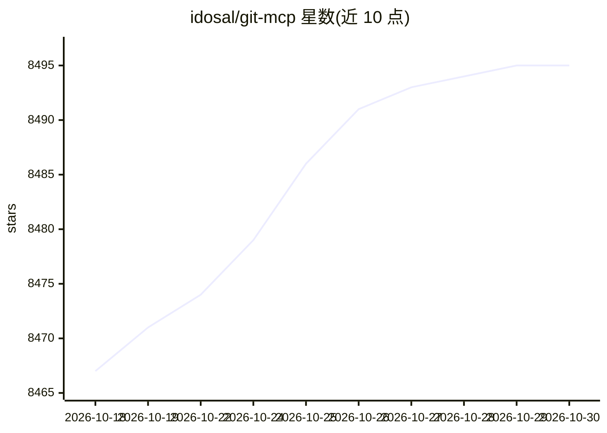

# idosal/git-mcp

⭐ 8,495 · TypeScript · Apache-2.0 · 推送 2026-05-08 · [GitHub](https://github.com/idosal/git-mcp) · [官网](https://gitmcp.io) · 个人维护

**把任意 GitHub 仓库变成文档 MCP 服务器的远程服务**

免费开源的远程 MCP 服务器：将任意公开 GitHub 仓库或 GitHub Pages 站点转换为文档访问端点，向 Cursor、Claude Desktop、VSCode、Windsurf、Cline 等 AI 编程助手暴露文档抓取、智能文档搜索、代码搜索与 URL 内容读取四类工具。文档来源按 llms.txt、AI 优化文档、README 顺序取用。云端运行零安装，也可自部署；提供仓库徽章与浏览器内嵌聊天。

## 筛选速览

| 维度 | 判定 | 备注 |
|---|---|---|
| AI 角色 | `ai-ecosystem` | LLM/agent 周边工具 |
| 许可风险 | `permissive` | Apache-2.0 |
| 部署形态 | `library` | 以包/库形式分发 |
| 模型依赖 | — | README 未给出锁定关系 |
| 硬件要求 | — | 无带数字的原话,不猜 |
| 安装摩擦 | `low` | 无编译、无系统依赖或容器化 |
| 成熟度 | — | 结构信号不足 |

## 能力要点

- gitmcp.io/{owner}/{repo} 专库端点与 gitmcp.io/docs 动态通用端点两种形式
- 提供文档抓取、智能文档搜索、代码搜索、链接内容读取四类 MCP 工具
- 云端运行，仅需在 IDE 中添加 URL 即可，无需下载或注册
- 支持自部署，不收集个人信息、不存储查询

## 适用场景

- 让 Cursor/Claude 等编程助手获取新库或快速迭代库的最新文档与代码
- 通过通用端点在对话中动态访问任意 GitHub 仓库文档
- 为自己的开源仓库提供 AI 可访问的文档端点与访问徽章

## 场景标签

`RAG` `语义搜索` · 领域:知识与检索

## 证据(README 行号)

> L25: GitMCP is a free, open-source, remote Model Context Protocol (MCP) server that transforms **any** GitHub project (r
> L175: GitMCP connects your AI assistant to GitHub repositories using the Model Context Protocol (MCP), a standard that l
> L292: Yes, GitMCP is compatible with any AI assistant supporting the Model Context Protocol, including tools like Cursor

## 星数曲线

2026-10-18 8,467 → 2026-10-30 8,495（+28）

---
*卡片 v1 · prompt 1.4 · 生成 2026-10-21 · 置信度 mid · 依据 README sha `578dfc1b0fbb` · [字段定义](../../DATASET.md)*
