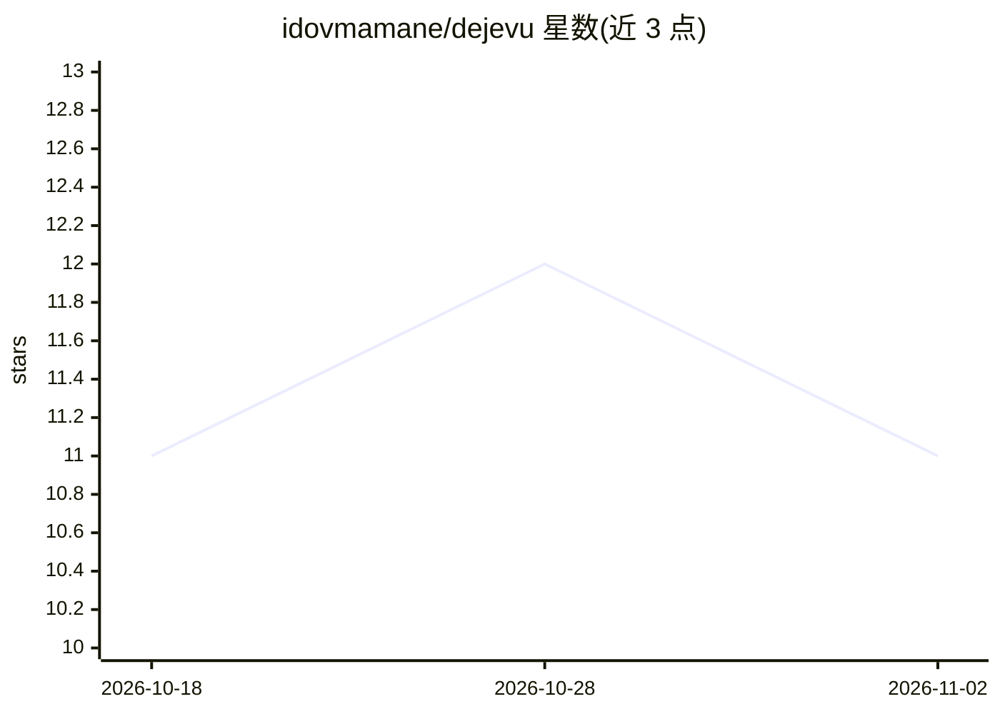

# idovmamane/dejevu

⭐ 11 · Python · MIT · 推送 2026-09-23 · [GitHub](https://github.com/idovmamane/dejevu) · 个人维护

**给开发者的浏览器操作 Agent：一次模型调用完成一个页面动作**

基于 LLM 的浏览器自动化 agent：模型返回单个 JSON 决策（操作/目标/文本），循环读取页面、执行动作直到任务完成，用代码而非模型自述验证结果。每个页面状态只发一次请求，采用页面静默检测替代固定等待、精简页面视图降低 token 用量；带守卫机制核验元素身份与状态后再执行输入。默认经 OpenRouter 接入任意 OpenAI 兼容端点，也支持 CDP 连接自有 Chrome；以 CLI 与 Python 库形式提供，附基准与 holdout 任务。README 自述局限：DOM 读取不覆盖闭 shadow root、跨域 frame 等，Windows 未测试。

## 筛选速览

| 维度 | 判定 | 备注 |
|---|---|---|
| AI 角色 | `ai-native` | 本体是模型或模型工具 |
| 许可风险 | `permissive` | MIT |
| 部署形态 | `None` |  |
| 模型依赖 | — | README 未给出锁定关系 |
| 硬件要求 | — | 无带数字的原话,不猜 |
| 安装摩擦 | `low` | 无编译、无系统依赖或容器化 |
| 成熟度 | — | 结构信号不足 |

## 能力要点

- 每页面状态一次模型调用，返回单 JSON 决策（op/target/text 等）
- settle 检测替代固定等待，页面静默后才发起下一次请求
- 守卫机制：执行前核验元素身份/角色/状态，DONE 仅在静默页面接受
- 支持任意 OpenAI 兼容端点与 CDP 连接自有 Chrome

## 适用场景

- 用自然语言目标驱动浏览器完成表单与检索任务
- 复现或扩展其 Flights/Wikipedia 基准任务
- 作为 Python 库嵌入自己的浏览器自动化流程

## 场景标签

`浏览器自动化` · 领域:效率与自动化

## 证据(README 行号)

> L5: **Jev? Déjà vu.** Browser agents that run on instinct, no Jev needed. One look at the page. One call to any open mod
> L80: - **One request per page state.** The model returns `{"op", "target", "text", "option", "key"}` as one JSON object.

## 星数曲线

2026-10-18 11 → 2026-11-02 11（+0）

---
*卡片 v1 · prompt 1.4 · 生成 2026-11-01 · 置信度 high · 依据 README sha `40e689d8b1ad` · [字段定义](../../DATASET.md)*
