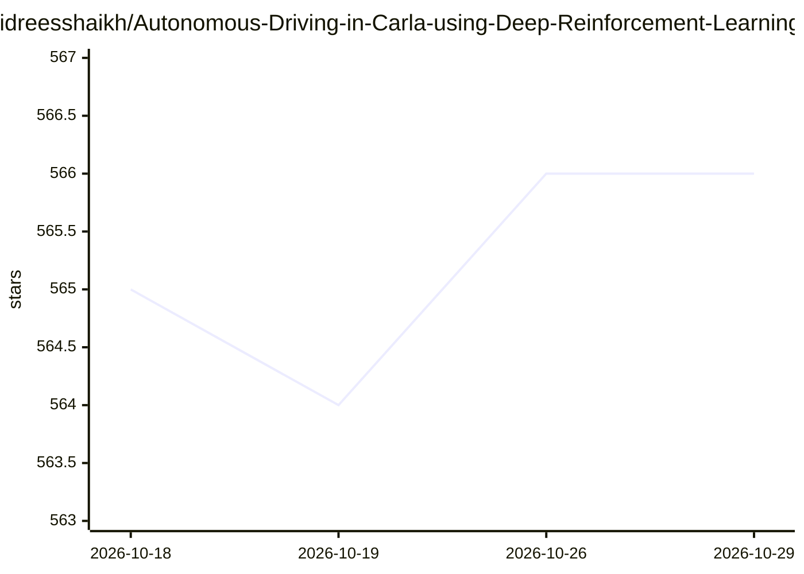

# idreesshaikh/Autonomous-Driving-in-Carla-using-Deep-Reinforcement-Learning

⭐ 566 · Python · MIT · 推送 2025-11-13 · [GitHub](https://github.com/idreesshaikh/Autonomous-Driving-in-Carla-using-Deep-Reinforcement-Learning) · 个人维护

**在 CARLA 仿真环境用 PPO 训练自动驾驶智能体的研究项目**

端到端的深度强化学习自动驾驶实验项目：在 CARLA 0.9.8 城市仿真器（Town 02/Town 07）中，先用 VAE 将 160x80 语义分割图像压缩为低维隐空间表示（训练时冻结 VAE 权重），再以 PPO 在连续状态与动作空间中训练驾驶智能体沿既定路线行驶并避撞。提供两个城镇的预训练模型、训练/测试脚本 continuous_driver.py，以及 Tensorboard 日志查看方式。面向强化学习与自动驾驶方向的研究者/学习者，需自行下载 CARLA 服务器与附加地图，限 Windows/Linux。另含进行中的 Duelling DQN 离散智能体脚本。

## 筛选速览

| 维度 | 判定 | 备注 |
|---|---|---|
| AI 角色 | `ai-native` | 本体是模型或模型工具 |
| 许可风险 | `permissive` | MIT |
| 部署形态 | `library` | 以包/库形式分发 |
| 模型依赖 | — | README 未给出锁定关系 |
| 硬件要求 | — | 无带数字的原话,不猜 |
| 安装摩擦 | `low` | 无编译、无系统依赖或容器化 |
| 成熟度 | — | 结构信号不足 |

## 能力要点

- VAE 压缩高维观测至低维隐空间辅助 PPO 训练
- 提供 Town 02 与 Town 07 的预训练 PPO 模型
- 基于 12,000 张语义分割图像的 VAE 训练流程
- Tensorboard 记录训练指标与曲线

## 适用场景

- 学习从零实现 PPO 应用于连续控制的自动驾驶
- 复现或扩展 CARLA 仿真中的端到端驾驶实验
- 对比隐空间表示对 DRL 训练效率的影响

## 场景标签

`强化学习` · 领域:训练与推理

## 证据(README 行号)

> L5: Moreover, DRL has shown promising results in learning complex decision-making tasks, from strategic games to challen
> L9: This work aims to develop an end-to-end solution for autonomous driving that can send commands to the vehicle to hel

## 星数曲线

2026-10-18 565 → 2026-10-29 566（+1）

---
*卡片 v1 · prompt 1.4 · 生成 2026-10-21 · 置信度 high · 依据 README sha `48f01c6bcc2c` · [字段定义](../../DATASET.md)*
